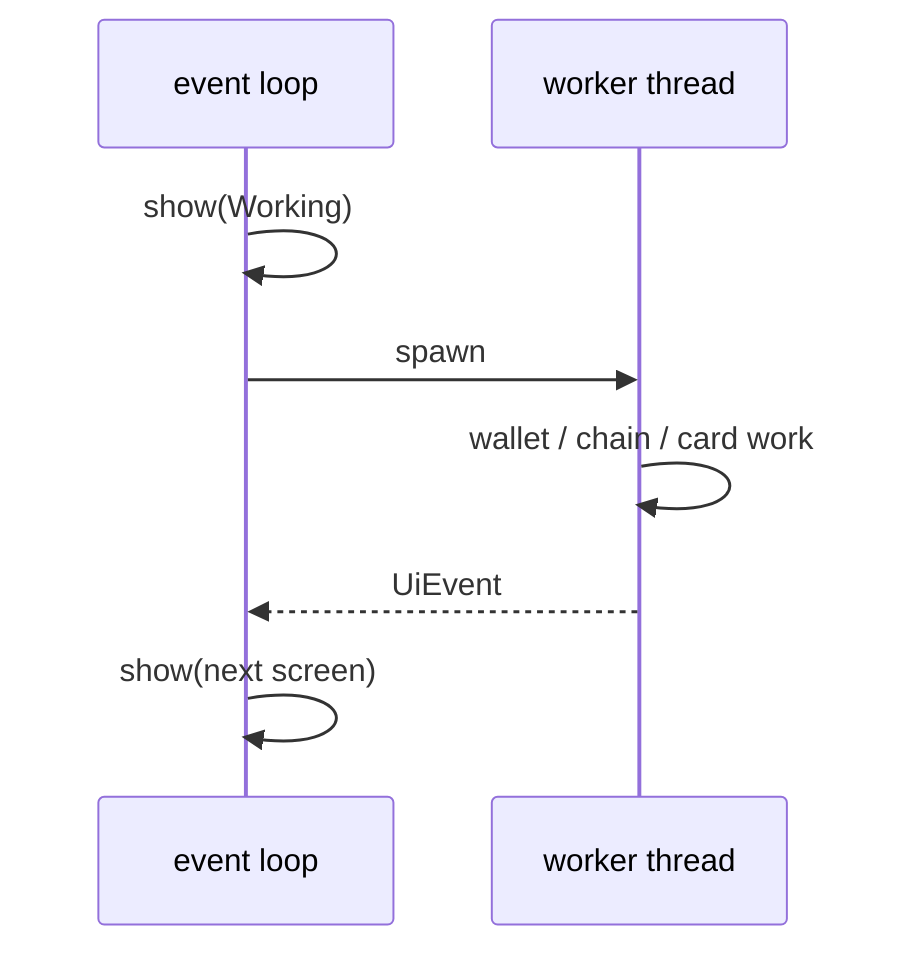

# The desktop client

`kenter-ui` is the primary surface. This page is about how it is built and
why; the API map is in [the crate reference](/reference/kenter-ui).

## Screens are data

No retained widget tree, no callbacks. A `Screen` is a plain enum of view
structs; building it produces a layout tree and a list of actions; painting
turns that into pixels. Input hit-tests to an `Action`, which the shell
handles and which produces the next `Screen`.

The payoff is that **behaviour is testable without a window**:

```rust
let ui = Ui::build_screen(&screen);
assert!(actions_on(&ui).contains(&Action::RestoreScanned));
assert!(text_on(&ui).contains("Restore what I have"));
```

Most of the crate's roughly 180 tests work this way. They cover states that are hard to reach by
hand — a half-failed restore, a camera too coarse to resolve a symbol, a
locked wallet asked to print paper — which is exactly where a GUI usually
has no coverage at all.

If you add a state, add a test like that.

## Why no toolkit

`winit` + `softbuffer` + `taffy` + `pelt` (SVG skins), rather than a GUI
framework. Three reasons:

1. **Appearance is data.** An artist edits an SVG in Inkscape; code
   references states and tokens inside it. No layout code changes to restyle
   a button.
2. **The render path is ours.** Blitting a camera frame into the scene, or
   rasterising a QR through the same cache as everything else, needs no
   escape hatch.
3. **Nothing hidden.** For a wallet, a dependency that can draw to the
   screen and read input is part of the threat model.

The cost is real and worth knowing: no accessibility layer, no text input
beyond what is hand-built, and one large crate that is slow to compile and
link.

## Threads

The event loop owns everything mutable. Work happens on threads and reports
back as `UiEvent` through an `EventLoopProxy`.



Two rules this enforces:

- **Nothing blocking on the event loop.** Opening a camera or a card takes
  long enough to be felt, so even failure arrives as an event.
- **`show()` is the only place a screen changes**, which makes it the one
  place that has to release the camera when the holder leaves the paper
  flow. No exit path has to remember.

Animation is frame-paced only while the current page says it animates
(`has_animation()`), so an idle client is genuinely idle.

## Custody is invisible to screens

Screens never learn whether custody is software or a card. They describe an
action; the `Authorizer` decides whether that needs a prompt, a card tap, or
nothing because the session is already unlocked.

This is why the tier difference — one session unlock versus a tap per
value-moving action — is a policy in `kenter-wallet` rather than a branch in
each screen.

## Flows

| Flow | Module |
|---|---|
| First run | `setup` |
| Unlock | `Locked` + `Prompt` |
| Billfold | `wallet` |
| Receive | `receive` (the largest flow) |
| Deposit / print | `deposit` |
| Pay | `pay` |
| Redeem | `redemption` |
| Settings | `settings` |
| Card provisioning | `card`, `card_setup` |
| Paper backup and restore | `Paper`, with `sheet`, `pdf`, `qr`, `scan`, `camera` |

### Why `Paper` is its own screen

Its import half has a state nothing else here does: **partial success as the
normal case.** Every other flow worked or did not. A scan gives you three
notes of four, and that is a result to act on, not an error to dismiss.

Hence a rule the tests pin: *"Restore what I have" is never greyed out.*
Three notes of four is three notes, and a holder who has genuinely lost a
sheet must not be trapped on a screen whose only exit is finding it.

## The mock binary

`kenter-ui-mock` renders every screen against fabricated data — no wallet,
no chain, no card. It is the fastest way to inspect a layout change and the
only practical way to look at states that need a specific failure to occur.

## Known gaps

- **No accessibility layer.** A consequence of the custom render path.
- **A failed payment is not persisted.** When a `spend` submission fails,
  the error message tells the holder to retry the same note or pay it to
  themselves (see [Bearer and spend mode](/architecture/spend-mode#the-receive-gates)),
  but the client does not keep the outstanding authorization as a pending
  state.
