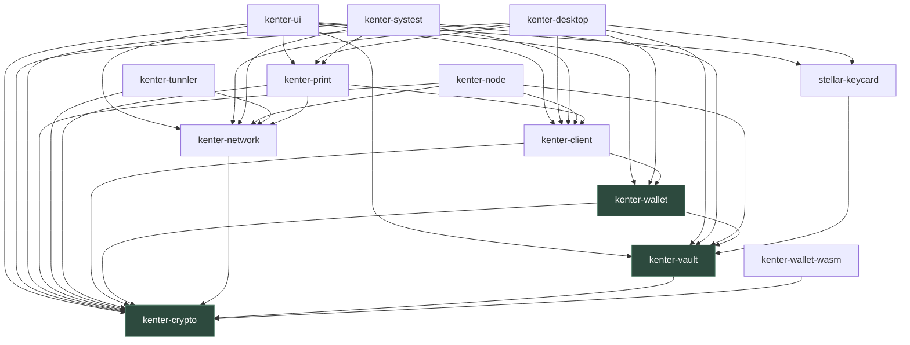

# The workspace

Thirteen crates under `crates/`, plus two Soroban contracts (and a test spike) under
`contracts/`. This page is the map: what each one is for, what it may depend
on, and where to look first.

## Dependency graph

Arrows point from a crate to what it depends on. Only internal dependencies
are shown.

The green crates are the wasm-safe core. Everything above them is an engine
or a shell.

## The core

### `kenter-crypto` — what a note is

The note container, the chain of links, the shard scheme, Path A redemption
requests, spend-mode primitives and the Stellar keypair wrapper. No I/O.

Everything else depends on this and it depends on nothing internal. If you
are learning the system, read `container.rs` and `chain_data.rs` first: they
define the bytes that everything else manipulates. `spend.rs` defines the
spend-mode messages. See [Bearer token format](/bearer-token-format).

→ [Reference](/reference/kenter-crypto)

### `kenter-vault` — what holds the keys

Two port traits (`KeyVault`, `DerivingVault`), a software implementation
(`SoftVault`), and the derivation stack beneath them: BIP-39 mnemonics,
SLIP-0010 HD derivation, BIP-85 child keys, Argon2id.

→ [Reference](/reference/kenter-vault) · [Custody and keys](/architecture/custody)

### `kenter-wallet` — what a holder owns

The wallet core. Held tokens, on-chain reconciliation, backup and restore,
paper encoding, authorization policy, and the receive/spend gates that are
protocol rather than preference.

Defines the port traits (`ChainRead`, `Store`, `Authorizer`, `Prompter`) that
shells implement, and enforces the spend-mode receive gates
([Bearer and spend mode](/architecture/spend-mode)). **Never** touches a socket, a file or a card.

→ [Reference](/reference/kenter-wallet)

## Engines

These exist so the core doesn't have to know about the outside world.

| Crate | Role |
|---|---|
| `kenter-client` | Native chain access — Soroban RPC, Horizon, transaction building (including pair-cosigned calls), the drand beacon (`beacon`), and the build's fixed network and relay list (`network`). Implements `ChainRead`. |
| `kenter-network` | The wire protocol and tunnel client: Stellar JWT auth, shard exchange, chain extension over WebSocket. |
| `kenter-print` | Runs a whole print with the network choosing its nodes (`print_selected`): request, seed, wait for claims, walk the selected pairs through their relays, skip any that do not serve, register. A wallet reaches nodes only through the build's relays. Its own crate because the CLI and GUI are siblings that cannot reach each other. |
| `stellar-keycard` | Keycard (JavaCard) custody over PC/SC. Implements the `kenter-vault` traits against hardware. |

## Shells

| Crate | Role |
|---|---|
| `kenter-ui` | **The primary surface.** Desktop GUI: winit + softbuffer + Taffy layout + pelt SVG skins. By far the largest crate. |
| `kenter-desktop` | CLI reference client and integration testbed — `print`, `inspect`, `balance`, `register`. |
| `kenter-wallet-wasm` | A spike, not a product. Proves `kenter-crypto` compiles and runs in a browser at acceptable size. |

## Services

| Crate | Role |
|---|---|
| `kenter-node` | A pair node, headless (`kenter-node run`) or in the desktop tray (`kenter-node-tray`). Keeps the pair on the roster and bound to a relay, serves `/kenter/health`, `/kenter/shard`, `/kenter/extend`, and takes part in selection: registers its pair, seeds and claims prints within a daily XLM allowance, and clears abandoned prints it is owed for. See [Node selection](/architecture/node-selection) and `crates/kenter-node/ARCHITECTURE.md`. |
| `kenter-tunnler` | The relay nodes and clients connect through. |
| `kenter-systest` | Brings up a relay and real nodes locally, points GUI clients at them, and checks the ledger after each operator step. Not automated — it stops and tells you what to do. |

## Contracts

| Contract | Role |
|---|---|
| `contracts/kenter-mint` | Escrow, print coordination, node selection, redemption, node fee accrual. No admin, no upgrade path. |
| `contracts/kenter-roster` | Node registry, bonds and membership. No admin. Gates relay access. |
| `contracts/drand-spike` | A test contract that verifies one recorded drand round and measures its cost. Not deployed. |

## Rules that keep the shape

These are not style preferences; breaking them breaks a target.

1. **`kenter-wallet` stays wasm-safe.** No `tokio`, no `reqwest`, no
   `std::fs`. Its `Cargo.toml` carries a comment saying exactly this. The PWA
   target depends on it.
2. **Shells depend on traits, not engines.** A shell picks an implementation
   at its edges; the core never learns which.
3. **`kenter-crypto` depends on nothing internal.** It is the bottom of the
   stack, and every other crate trusts its bytes.
4. **Custody is behind `KeyVault` / `DerivingVault`.** Code that assumes a
   seed is reachable in memory will fail on a card.

## Rough sizes

Lines of Rust under each crate's `src/`, tests included. Useful for judging
how much is behind a name.

| Crate | Lines |
|---|---|
| `kenter-ui` | ~21,600 |
| `kenter-wallet` | ~7,600 |
| `kenter-client` | ~6,000 |
| `kenter-node` | ~5,300 |
| `kenter-crypto` | ~5,100 |
| `kenter-tunnler` | ~3,200 |
| `stellar-keycard` | ~3,100 |
| `kenter-systest` | ~3,000 |
| `kenter-vault` | ~2,800 |
| `kenter-network` | ~2,500 |
| `kenter-desktop` | ~2,000 |
| `kenter-print` | ~830 |
| `kenter-wallet-wasm` | ~170 |
