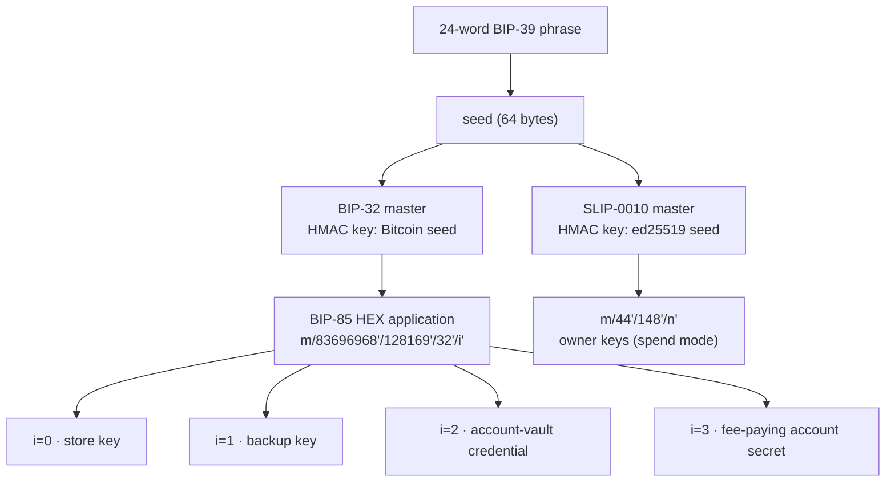

# Custody and keys

Everything a holder owns descends from **one 24-word BIP-39 phrase**. If you
understand the derivation tree you understand most of what can go wrong in a
recovery.

## The two traits

`kenter-vault` defines custody as two port traits, deliberately separate.

**`KeyVault`** — slot-based custody of Ed25519 **Stellar account keys**. A key
is named by a `SlotId`. This is the identity/signing key a client uses.

**`DerivingVault`** — one seed, HD-derived **owner keys** for spend mode. A key
is named by a derivation index recorded on the held note.

They are not folded together because the roles differ in lifetime and in what
identifies a key. A slot is a place; an index is a position in a sequence.

Two implementations:

- **`SoftVault`** (`kenter-vault`) — keys encrypted at rest under a passphrase.
- **Keycard vault** (`stellar-keycard`) — a JavaCard secure element over PC/SC.

Client code depends on the traits. Code that assumes it can reach the seed in
memory works in software and fails on a card, which is the single most common
way to break card custody.

## The derivation tree

::: danger Two different masters, both from the same seed
BIP-85 derives through a **BIP-32** master, whose HMAC key is the ASCII string
`"Bitcoin seed"`. Owner keys derive through a **SLIP-0010** master, whose HMAC
key is `"ed25519 seed"`. They are different trees from the same seed. Using
the wrong master silently produces valid-looking keys that open nothing.
:::

## The four BIP-85 children

All four are the HEX application at 32 bytes, differing only by index.
BIP-85 children are independent by construction, so leaking one says nothing
about the others — which is why these are separate indices rather than tags
off one secret.

| Index | Constant | What it is |
|---|---|---|
| 0 | `STORE_KEY_INDEX` | Encrypts the sealed note store |
| 1 | `BACKUP_KEY_INDEX` | Encrypts backup files (`.kbk`) and paper items |
| 2 | `ACCOUNT_VAULT_KEY_INDEX` | Opens the account vault on a card-custody wallet |
| 3 | `ACCOUNT_KEY_INDEX` | **Is** the fee-paying Stellar account's secret |

Two of these need explaining.

**Index 2 exists because a card wallet has no passphrase.** A card-custody
wallet still has one software key — the Stellar account that pays fees, kept
off the card deliberately, since a hot key gains nothing from a secure
element. But it must still be protected at rest, and there is no passphrase to
protect it with. So the `SoftVault` holding it is opened with this child. The
card stays the single unlock, and a holder restoring from the phrase derives
the same credential.

::: warning Index 2 is permanent
A wallet provisioned against index 2 cannot later be opened by a build that
derives that credential anywhere else.
:::

**Index 3 makes the fee-paying account recoverable from the phrase alone.**
A randomly generated account, stored only in the vault, would be recoverable
from *phrase plus vault file* and never from the phrase by itself. That would
make the vault file a third artefact a holder must not lose, and recovery is
designed to need only the phrase and the backup.

It matters because **redemption pays into this account**. With a random
account, a holder could restore every note from their phrase and a backup and
still find the proceeds of already-redeemed notes at an address nobody can
sign for: the notes come back, the money does not. Deriving the account from
the seed removes that class of partial recovery.

It is deliberately *not* an `m/44'/148'/n'` index: an account sharing a key
with an owner would link a holder's fee payments to the note they paid for.

## Owner keys

Spend mode owner keys are SLIP-0010 Ed25519 at `m/44'/148'/n'` — purpose 44,
Stellar coin type 148, hardened throughout. The index `n` is recorded on the
held note so the right key can be re-derived later.

The contract verifies owner authorizations with `ed25519_verify`, so these are
**Ed25519**, in software and on the card alike. The card derives the same path,
so a card can take over a software wallet's notes.

Two indices have fixed meanings (`kenter_wallet::models`):

- `STATIC_RECEIVE_INDEX = 0` — the holder's standing pay tag.
- `FIRST_FRESH_INDEX = 1` — where per-note fresh indices begin.

## On a card

Kenter uses the card **through `DerivingVault` only**. The card holds the seed
and signs owner proofs; the fee-paying Stellar account stays a software key in
a `SoftVault`, opened with BIP-85 child 2.

The rule matters because `StellarKeycard` also implements `KeyVault`, and on
the card a `KeyVault` slot and a `DerivingVault` index with the same number
derive the same key (`m/44'/148'/n'`). If the account lived at slot 0 on the
card, owner index 0, the standing pay tag, would commit to the account's
public key. The account is public by construction, since it deposits and
redeems on the ledger, so every payment to the pay tag would become
recognisable. Keeping the account in software also keeps two factors apart:
the account signs the transaction, the card signs the owner proof, and
neither alone moves a note.

A wallet's seed has one of three origins, recorded as `seed_origin` in its
backups because each has a different recovery path:

| Origin | Where the seed lives | Recovery |
|---|---|---|
| `software` | `SoftVault`, encrypted at rest | The phrase |
| `bip85-child` | A root held elsewhere (normally the card); the software seed is a BIP-85 child of it | The root plus the child index; one phrase covers both |
| `card` | On the card | The card, or its phrase if one was written down |

## Passphrase protection

`SoftVault` encrypts at rest with **Argon2id**, defaults in
`kenter_vault::kdf`:

| Parameter | Value |
|---|---|
| Memory | 19,456 KiB (19 MiB) |
| Iterations | 2 |
| Parallelism | 1 |

Content encryption is XSalsa20-Poly1305.

## The backup fingerprint

`backup_fingerprint` reduces a seed (or a BIP-85 child) to a short hex string
that identifies a wallet without revealing anything about it. It appears in
backup file headers and in every paper symbol, so a holder can be told *"those
sheets belong to a different wallet"* before any key is involved.

## Where to read more

- [Data formats](/architecture/data-formats) — what the backup and paper
  containers look like
- [Bearer and spend mode](/architecture/spend-mode) — how owner keys are
  allocated, committed to and used
- [Keycard hardware](/testing/keycard) — testing card custody on real
  hardware
- [Security model](/architecture/security-model) — what custody protects
  against, and what it cannot
