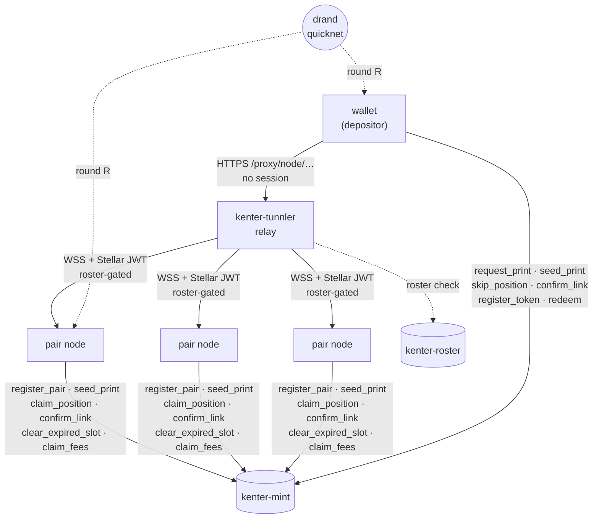

# Network and contracts

## Topology

Nodes keep no memory of prints beyond their own keys, the replies they
recently served, and the slots they are owed for. The partial token carries
everything needed to extend it.

**Nobody names the interior pairs.** In `request_print` the depositor names
only its own two end pairs, which are exempt from the roster and
distinctness checks. The interior positions are filled by selection:

1. `request_print` escrows the deposit and fixes a drand round `R` that has
   not been published yet.
2. Once `R` is out, anyone posts its signature with `seed_print`. The mint
   verifies it and derives the seed.
3. Registered pairs score themselves, `sha256(seed ‖ pair)`, and those that
   may win call `claim_position` during the claim window. The mint keeps the
   lowest `2k` scores: the first `k` are the positions, the rest runners-up.
4. The depositor walks the chain through the selected pairs. A pair that does
   not serve within the serve timeout is replaced by a runner-up with
   `skip_position`, at a burned fee the depositor pays.
5. The depositor closes the chain locally and registers the note.

A pair may claim only if it registered with the mint (`register_pair`) in a
ledger before the print was requested, so its pairing is set before the
seed could be known. `min_pairs` is at least 3, so every print has at least
one pair the depositor did not choose. Abandoning a print after a draw exists
forfeits a fee per unconfirmed interior position, so re-rolling a draw is
priced. The full mechanism, with timings and refunds, is [Node
selection](/architecture/node-selection).

::: tip `vrf_proof` is reserved, not used
The container carries an `initiation_proof.vrf_proof` field, and every
caller passes it empty. Selection uses the drand beacon, verified by the
mint, so nothing generates or verifies a VRF.
:::

## How a print reaches a node

The wallet has **no node list and no relay setting**. It learns the
selected pairs from the slot (`SlotInfo::chain`) and reaches each one
through the relay that pair's roster endpoint names
(`kenter_print::Reach::Roster`):

- A node's roster endpoint is `https://<node address>.<relay host>`, for
  example `https://<G...>.relay.example.org`. `relay_host_of` accepts only
  that shape: https, the node's own address as the first label, and a public
  host name (no IP literal, no `localhost`).
- **The relay must be one of the release's relays** (`Profile::relays` in
  `kenter-client`). A node that names any other host is treated as one that
  does not serve, and is skipped. Otherwise an operator could name a host of
  their own and learn the IP of every depositor its pair is selected for. A
  build whose relay list is empty reaches no node and fails closed.
- Requests go as plain HTTPS to the relay's open `/proxy/<node>/<path>`
  route (`NodeRelay`). The depositor opens no relay session and signs in
  with nothing, so the relay learns its IP but not its Stellar address. A
  roster-gated relay admits only roster members as sessions, and depositors
  are not members.
- `NodeRelay` follows no redirects and reads at most `MAX_REPLY` (256 KB) of
  a reply. Its timeout is 130 s, because a node answers `extend` only after
  its `confirm_link` lands.

`Reach::Fixed` sends every request through one relay. It exists for local
test rigs (`kenter-systest`, `kenter-desktop print-net --relay`) whose relay
advertises a domain it is not reachable at.

Nothing a print sends is secret. Links and partial keys are published on the
ledger as each node confirms, and the depositor's own shards, the final link
and the claim key never leave the wallet.

## The relay

`kenter-tunnler` authenticates **nodes** with Stellar-signed EdDSA JWTs
(challenge-response) over a WebSocket, and checks the **on-chain roster**
before admitting one. It forwards HTTP arriving at `/proxy/<address>/<path>`
(or at the node's subdomain) down that node's tunnel.

That roster check is the most common cause of a local network that looks
broken: a node authenticates and is then refused, because its address was
never registered or its record is inactive.

A node configures an ordered list of relays (`node.json`) and binds to the
first that answers, falling back down the list. The endpoint a relay assigns
is checked before it is written to the roster: it must be
`https://<own address>.<the relay's own host>`.

- [Relay API](/tunnler-api)
- [Relay deployment](/DEPLOY)

## The node endpoints

| Endpoint | Purpose | Needs |
|---|---|---|
| `/kenter/health` | Liveness, and the pair's two addresses | — |
| `/kenter/shard` | Path A redemption | **This node's own secret only** |
| `/kenter/extend` | Printing | Its own and its partner's |

`/kenter/shard` re-derives the pair's shard by ECDH against the partner
public key **carried in the `ChainLink`**, checks it against the link's
commitment and partial key, and encrypts it to the combiner. That is why no
node ever holds enough to reconstruct a note. `ShardRateLimiter` allows one
response per link per 15 minutes, because this is the endpoint an attacker
could usefully hammer.

`/kenter/extend` is reachable by anyone through the relay, so before
extending the node reads the slot and checks the request against it
(`SlotInfo::admits_next`): the slot's event id, exactly the links already
confirmed, each signed by the pair the slot assigns it, and this pair next.
After extending it submits `confirm_link`, and a failed confirmation fails
the request. A node remembers its last `SERVED_KEEP` (64) replies by a hash
of the exact request, so a depositor whose reply was lost in transit gets it
again without a second confirmation.

## The contracts

### `kenter-roster`

Node registry and membership. It gates relay access for nodes, records each
node's relay endpoint, and decides who is selectable (active and not
unbonding). It does not hand clients a node list.

| Group | Entry points |
|---|---|
| Lifecycle | `join`, `volunteer`, `update_node`, `heartbeat`, `leave`, `withdraw_stake` |
| Queries | `is_node`, `node_terms`, `is_volunteer`, `get_node`, `get_node_count`, `lookup`, `get_config`, `min_stake`, `symbol` |
| Storage rent | `bump` |

Joining locks a bond (`min_stake`, in the roster's pay token). After `leave`
the bond stays locked for `unbonding_ledgers` before `withdraw_stake` returns
it. That delay is what makes a roster identity cost something rather than
being a refundable deposit. The deploy script uses 150 XLM and one week
(120,960 ledgers).

**There is no admin.** Nobody can remove a node or take a bond. Failing to
serve is not provable on chain, so there is nothing a removal could be
justified by; the price of a Sybil is cost to enter and time to exit.

**Volunteers.** A node may `volunteer`: it serves on the same terms, but the
mint burns its fees instead of crediting them. A depositor pays the same
whoever prints. The flag is permanent for that address, so a fleet cannot
volunteer for a while and switch to paid later.

A node's record is kept alive by its own `heartbeat`.

### `kenter-mint`

Escrow, print coordination, redemption and node fee accrual. No admin, no
withdrawal entry point, no upgrade path: every parameter is fixed at deploy.

| Group | Entry points |
|---|---|
| Printing | `request_print`, `confirm_link`, `cancel_print`, `clear_expired_slot`, `is_slot_expired`, `get_slot` |
| Selection | `seed_print`, `register_pair`, `unpair`, `claim_position`, `skip_position`, `selection`, `pair_of` |
| Registration | `register_token`, `get_token`, `get_token_state` |
| Value | `spend`, `redeem_by_key`, `redeem_by_key_owned`, `redeem_by_chain`, `redeem_by_chain_owned`, `is_redeemed`, `redeemed_at` |
| Node economics | `claim_fees`, `accrued_fees` |
| Storage rent | `bump`, `bump_token` |
| Config | `node_fee`, `min_pairs`, `max_pairs`, `pay_token`, `roster`, `max_print_ledgers` |

The constructor refuses `min_pairs` below 3 and `max_pairs` above 12. Twelve
is set by what a holder can carry: a larger note costs too much card storage
and too many paper symbols, all of which must read. The deploy script uses
`min_pairs = 3`, `max_pairs = 8` and `node_fee = 25,000` stroops of the pay
token.

**Node fees accrue; they are not paid at the moment they are earned.**
Redemption credits each interior participant a claimable balance, and a node
collects with `claim_fees` whenever it likes. That lets a node be paid for a
print it served while offline, and it is why `Accrued(address)` is a ledger
entry with a rent cost of its own.

The fee is flat per participant and charged for interior pairs only:
`node_fee × 2 × (pairs − 2)`. The depositor's end pairs are neither charged
nor credited. A volunteer's fee is burned instead of credited.

**A print slot is two ledger entries**: a persistent core, `Slot(id)`,
holding the escrow and every fixed-size fact, which never grows; and a
temporary draw, `Draw(id)`, holding what selection grows (pairs, seed,
claims, partial keys, confirmers). Both live to one fixed end, a day past
the print window. `get_slot` assembles both; a client reading entries
directly must read `Draw` at temporary durability. Why, and what happens if
the draw lapses, is in [Node selection](/architecture/node-selection#where-a-slot-lives).

The full interface is `contracts/kenter-mint/API.md`.

## Redemption paths

| | Path A | Path B |
|---|---|---|
| Entry point | `redeem_by_key(_owned)` | `redeem_by_chain(_owned)` |
| Needs | Shards from the printing pairs, and the claim key or owner key | The note file, and the claim key or owner key |
| Network | Live nodes, and a combiner | None |
| Privacy | Chain stays private | Chain becomes public |
| In the client | Not driven | **Yes** |

Path B verification costs roughly `1.6M + 3.81M · pairs` CPU instructions,
well inside the network's transaction limit at twelve pairs.

## Building a transaction

Soroban needs **simulate, then send**: simulation computes the footprint and
resource fees the real submission requires. `kenter-client`'s
`SorobanRpcClient` and `TxBuilder` handle both, and `tx.rs` carries the
`ScVal` conversion helpers you need for any new call.

`register_pair` and `claim_position` need both members of a pair to sign;
they go through `TxBuilder::invoke_cosigned`, the one exception to "sign for
the source account only". It adds exactly one auth entry for the named
co-signer, rooted at exactly this call with nothing beneath, with a 60-ledger
expiry, and re-simulates in enforcing mode before sending. A claim writes to
a slot other pairs are claiming on at the same moment, so it declares a
`ContentionMargin` beyond what its simulation saw.

::: danger Argument types must match the contract exactly
A `u32` where the contract wants `i128` compiles on the Rust side and then
fails at runtime as an opaque simulation error, because the type checker
does not cross the contract boundary. The roster's `min_stake` and `staked`
are `i128`, as are the amounts in its node events. Read the signature in
`contracts/` rather than inferring it.
:::

## Which network a build talks to

The network is fixed when the binary is built (`kenter_client::network`). A
default build is a testnet client; a build with the `mainnet` feature talks
to mainnet, and nothing set at runtime can change that.

- The RPC and Horizon endpoints can be overridden (`KENTER_RPC`,
  `KENTER_HORIZON`, or the Settings field). A custom endpoint is checked
  against the build's network passphrase before it is trusted.
- The contract ids come from the network profile in
  `crates/kenter-client/src/network.rs`. On testnet they can be overridden
  with `KENTER_MINT` and `KENTER_ROSTER`. A mainnet build compiles them in
  from `KENTER_MAINNET_MINT` and `KENTER_MAINNET_ROSTER` and cannot override
  them; built without them, it refuses to start.

Pointing a client at a mint other than the one matching this source produces
a session where everything appears to work and nothing shows up. Testnet
facts that keep getting re-derived (friendbot, the USDC issuer, trustline
commands) are in [Testnet environment](/TESTNET).
