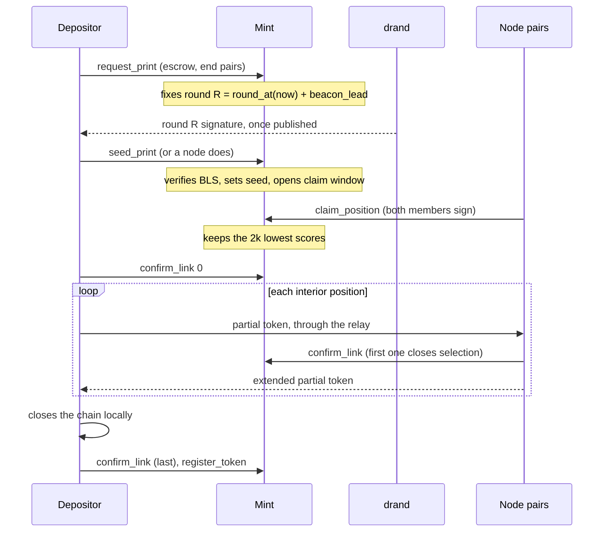

# Node selection

Nobody chooses the nodes that print a note. The depositor names only its own
two end pairs. A drand round that does not exist yet when the print is
requested seeds a draw, registered node pairs claim positions in it, and the
mint keeps the lowest scores. This page describes that mechanism: the slot,
the seed, claims, scoring, how nodes decide whether to claim, skips,
cancellation, refunds and the storage the slot uses.

The entry points named here are listed with their arguments and errors in
`contracts/kenter-mint/API.md`. The node's side is
`crates/kenter-node/src/select.rs`; the depositor's side is
`kenter_print::print_selected`.

## Why selection exists

A print is a chain of links, each contributed by a pair of nodes. If the
depositor picked the interior pairs, three things would follow:

- **Fee capture.** A depositor could route every fee to pairs it runs, and
  print at no cost.
- **Fake work records.** The ledger would show "independent" pairs that
  were one party.
- **Targeted observation.** A coalition could arrange to see the prints it
  cares about.

None of these is theft. The depositor closes the chain with its own pair,
and no coalition of interior nodes can redeem a note it never received (see
[Security model](/architecture/security-model)). Selection is a privacy and
fairness measure: it makes a coalition's share of positions track its share
of staked pairs, and nothing else.

It also removes the need for a node list. The roster answers one address at
a time and cannot enumerate its members, and the wallet carries no list of
nodes. Nodes come to the print instead.

## The parties and the terms

| Term | Meaning |
|---|---|
| Slot | The mint's record of a print in progress, named by `slot_id` |
| `total_pairs` | Links in the chain, between `min_pairs` and `max_pairs` |
| End pairs | Links `0` and `total_pairs − 1`. The depositor's own keys. Exempt from the roster and distinctness checks, never paid |
| `k` | Interior positions, `total_pairs − 2`. `min_pairs` is at least 3, so `k ≥ 1` |
| Round `R` | The drand quicknet round the slot is bound to |
| Seed | A hash of round `R`'s signature, the mint and the slot |
| Claim | A registered pair asking for a position, with its score |
| Runner-up | A claim ranked below the `k` winners, kept as a backup |

## The lifecycle



### 1. Pairs register before any draw

A node pair registers once with `register_pair`. Both members sign. Both must
be selectable on the roster and at least `min_node_age` ledgers old, and an
address can be in at most one registered pair. Either member can dissolve the
pair with `unpair`, which removes both records; registering again writes a
new registration ledger.

A pair may claim in a slot only if it was registered **in a ledger strictly
before the slot was requested**. The beacon round is fixed at request, so the
pairing is set before anyone can know the seed. Without this, an
operator holding many addresses could compute the score of every possible
pairing once the seed was public and claim with the best one.

### 2. The request

`request_print(caller, event_id, amount, total_pairs, first_pair, last_pair)`
escrows `amount` of the mint's pay token and opens a slot. The depositor names
its two end pairs and nothing else. The mint checks:

- `total_pairs` is within `[min_pairs, max_pairs]`;
- `amount > 2 · node_fee · k`, the reserve that covers every fee and forfeit
  an abandoned print can owe;
- `event_id` has never been used. The name is never released, not even by
  cancelling, because it is how every off-chain party refers to a print;
- no end pair names the mint itself.

It then fixes the beacon round:

```
R = round_at(ledger timestamp) + beacon_lead
```

`beacon_lead` is 20 rounds (60 s) in the deploy script, so round `R` has not
been published when the request lands, even if ledger close time trails wall
time.

### 3. The seed

drand quicknet is a threshold-BLS randomness beacon run by independent
organisations. It publishes a round every 3 seconds. A round's value is a
BLS12-381 signature on G1 over `sha256(round as u64, big-endian)`, verifiable
against the group key on G2 (scheme `bls-unchained-g1-rfc9380`). A BLS
signature is unique: for a given round exactly one signature verifies.

The mint cannot fetch drand; a contract makes no network calls. Anyone
fetches round `R` from a public mirror and posts it:

```
seed_print(slot_id, signature)
```

The mint checks `e(sig, −g₂) · e(H(sha256(R)), pk) = 1` with drand's
hash-to-curve tag, then sets

```
seed = sha256("kenter:select:v1" ‖ mint address XDR ‖ slot_id (u32 BE) ‖ sha256(sig))
claim_deadline = current ledger + claim_window
```

Mixing in the mint and the slot keeps two prints that share a round from
sharing a draw. Because the signature is unique, whoever posts it chooses
nothing; withholding it only delays the print. Verification costs about 28M
CPU instructions, well inside the transaction limit.

The depositor's client normally seeds. A node daemon seeds a slot only when
its own pair would claim there (step 5), after an 8-second grace for the
depositor, with lower-scoring pairs going first across a 20-second spread.
The daemon re-reads the slot just before sending, so usually exactly one node
pays for the seed.

drand's group key, genesis time and period are constructor parameters. Like
every mint parameter they are immutable.

#### If the beacon is down: the fallback seed

If nobody has posted round `R` by `fallback_delay` seconds after it was due
(600 s on both networks), anyone may seed the slot without the beacon:

```
seed_fallback(slot_id)
seed = sha256("kenter:select:fallback:v1" ‖ mint address XDR ‖ slot_id (u32 BE) ‖ R (u64 BE))
```

Everything after the seed is unchanged: the claim window opens, pairs claim
and score the same way, and the slot settles as any seeded slot does. A slot
seeded either way refuses the other (`AlreadySeeded`).

The fallback exists so that issuance does not depend on drand. If drand
pauses, prints wait about ten minutes instead of expiring; if quicknet were
retired, this mint keeps issuing. What it gives up is unpredictability while
the beacon is down: the fallback seed is fixed by the slot, so it can be
computed from the request onward. During an outage a depositor can therefore
choose when to request, and so choose the draw. That is the steering the
beacon exists to prevent, and it buys the same thing: fee capture, never
another holder's funds. No caller can choose the fallback seed, so a
coalition of nodes cannot steer it.

While the beacon is up the fallback is never used: daemons post round `R`
within seconds, long before the fallback opens. The constructor refuses a
`fallback_delay` under 300 seconds, because a fallback open as soon as the
round is due could race it and make every draw steerable.

A daemon or wallet that cannot fetch the round waits for the fallback to
open and seeds with it, in the same score order as it would have seeded
from the beacon.

### 4. Claims and scoring

A pair claims with `claim_position(slot_id, node_a, node_b)`. Both members
sign, so nobody can enter an honest pair into a print it did not agree to
serve. The mint computes the score itself:

```
score = sha256(seed ‖ lo ‖ hi)
```

where `lo` and `hi` are the two addresses' XDR in bytewise order, so a pair
cannot claim in both orders and keep the better score. A claim is accepted
only if:

- the slot is seeded and not closed;
- the pair is registered with each other, before the request (step 1);
- both members are selectable on the roster and at least `min_node_age`
  old. Their paid or volunteer terms are recorded with the claim;
- neither address appears in the end pairs or in any claim already held;
- the score would rank inside the list.

The mint keeps claims sorted by score and **caps the list at `2k`**: `k`
winners and one runner-up per position. A lower score displaces a higher one
whenever it arrives, so arriving first earns nothing, and more bots or a
faster connection earn nothing either. A claim that would fall off the end is
refused at once (`ClaimNotCompetitive`), so a losing pair stops paying.

After the deadline, claims are accepted only while the list holds fewer than
`k`. That fills a short draw without reopening a full one.

### 5. Who claims: sortition

If every pair claimed every print, each print would cost the whole roster a
transaction. A daemon claims only when its score is below a threshold chosen
so that roughly a constant number of pairs claim, whatever the roster's size:

```
p = C · 2k / P̂ · share
claim when  score / 2²⁵⁶ < p        (always, when p ≥ 1)
```

- `C` is 3, so about `3 · 2k` pairs claim per print.
- `P̂` is the daemon's estimate of how many pairs are live (below).
- `share` is the part of the daemon's daily allowance still unspent (see
  [What a node spends](#what-a-node-spends)). As the allowance drains, the
  threshold tightens, so the claims a node has left go where it is most
  likely to win.

If the window has passed and the slot still has fewer than `k` claims, any
pair claims whatever its score. An overestimated `P̂` then costs time, not
the print. Those short-list claims draw on a reserve of their own.

The threshold is advice to daemons, not a contract rule. A pair above it that
claims anyway pays its own fee and loses on score unless too few others
claimed.

### The live-pair estimate

The roster's node count includes every pair that joined and has not left,
including machines that are switched off and nodes whose keys are gone. Using
it directly would make live pairs claim too rarely. Each daemon estimates the
number of live pairs from evidence it already reads.

Once a slot's positions are fixed, the daemon recomputes every claim's score
from the seed and records the `k`-th lowest score `s_k` as a fraction of
`2²⁵⁶` (or the `j`-th, `j < k`, when fewer claimed). With `P` live pairs the
`k`-th lowest of their scores is about `k / (P + 1)`, so

```
P̂ = Σ k / Σ s_k − 1,   clamped to [1, roster pairs]
```

over the slots seen in the last 24 hours, at most 50, kept in memory. Until
three slots of evidence exist, the daemon uses the roster count.

The lowest `k` scores are ones every live pair claims at any reasonable
allowance, so the estimate does not depend on anyone's threshold. Fake
claimants need registered, staked pairs, and inflating `P̂` only makes honest
pairs claim less often. When allowances are very low (below about
`1 / (2C)` of a day's budget) the throttle can hide the `k`-th score and bias
`P̂` down; the short-list fallback bounds what that costs.

### 6. Closing selection and the walk

Selection closes lazily, at the **first interior `confirm_link`** (or at a
skip). That call needs the deadline passed and at least `k` claims. The `k`
lowest scores become positions `1..=k` in ascending order; the claims below
them become the ordered runner-up list. Nothing is accepted after closing.

The positions can be read before closing: once the deadline has passed with
at least `k` claims, no claim can change them, so `claims[0..k]` of
`get_slot` are the positions in order. That is how the depositor knows where
to send each extend request, and how a node knows it was chosen.

The depositor's client then:

1. confirms link 0 itself;
2. sends the partial token to each selected pair in turn, through the relay
   named in that pair's roster endpoint (see
   [Network and contracts](/architecture/network));
3. checks every extension before the next pair sees it;
4. closes the chain locally with its own last pair, confirms the last link
   and calls `register_token`.

Each interior pair calls `confirm_link` itself, so the mint learns of each
link from the node that made it, not from the depositor. The caller of an
interior link must still be on the roster at that moment. Every
`confirm_link` starts the next position's serve clock.

A node answers `/kenter/extend` only for a request that matches the slot:
the slot's event id, exactly the links already confirmed, each signed by the
pair the slot assigns it, and this pair next. After extending it submits its
`confirm_link`, and a failed confirmation fails the request. It keeps its
last 64 replies, keyed by a hash of the exact request, so a depositor whose
reply was lost in transit gets the same reply again without a second
confirmation. The wallet asks again up to three times.

## When a selected pair does not serve

Home machines go offline. If the pair at the next interior position has not
confirmed within `serve_timeout` ledgers (12 in the deploy script, about a
minute), the depositor calls `skip_position`. The best runner-up takes the
position and the skipped pair earns nothing.

The serve clock for a position starts at the later of: the moment positions
became fixed (the claim deadline, or the claim that filled a short list), and
the confirmation of the previous link. A skip resets it for the replacement.

**A skip costs the depositor `2 · node_fee`, burned.** The mint cannot tell
a dead node from a depositor who never sent the request, so every position
the depositor throws away costs one pair's fee. Without that, skipping honest
pairs to reach one's own runners-up would be free. The fee is transferred
from the depositor at the time, not taken from the escrow, so the escrow
always equals the note's face value.

Runners-up are pairs that already claimed: they were online moments ago and
have a known score. Keeping one per position lets the print survive about one
dead pair per position without a full cancel and restart.

If the slot runs out of runners-up (`NoBackup`), the print cannot complete
and the depositor cancels.

## Cancellation, expiry and refunds

A depositor who dislikes a draw could cancel and request again until its own
pairs win. Abandoning a print is therefore priced by when it happens.
`cancel_print` (depositor, while printing) and `clear_expired_slot` (anyone,
after `max_print_ledgers`) settle the same way, with one exception:

| Abandoned when | Settlement |
|---|---|
| Before round `R` is published | Full refund. No draw exists yet |
| Round `R` published, never seeded, **cancelled** | Forfeit (below). Anyone can fetch `R` and compute the draw, so declining to seed and cancelling is a re-roll |
| Never seeded, **expired** | Full refund. This is the case where the beacon stalled. A depositor who withholds the seed to get here locks the deposit for the whole print window per attempt |
| Seeded (by the beacon or the fallback), window closed with fewer than `k` claims | Full refund. The draw could not complete |
| Seeded, otherwise | Each confirmed interior link pays `node_fee` to the address that confirmed it. `2 · node_fee` is burned for every interior position not yet confirmed. The rest is refunded |

"Published" uses the same arithmetic as `round_at`: the round's time is
`genesis + (R − 1) · period`, compared with the ledger's close time.

The amounts always fit the reserve taken at request. Settlement pays at most
one fee per confirmed interior link and forfeits two per unconfirmed
position, so together at most `2 · node_fee · k`, which `request_print`
required the escrow to exceed.

**What a re-roll costs.** Each attempt burns about one print's fees and
takes over a minute. For a depositor holding a share `f` of the selectable
pairs, an attempt wins every interior position with probability about `fᵏ`.
At `f = 10%` and `k = 3`, that is about a thousand prints' fees per success.

**Only the confirmer is paid** on an abandoned print, not both members of the
pair: either member may confirm, a shard is derivable by either one alone,
and the address that put its name to the link is all the chain can prove. A
volunteer's fee is burned instead of credited, as at redemption. The end
links are never paid.

A pair that confirms its link and then withholds the extended token is paid
for that link, and the print ends in a cancel. The mint cannot tell a
withheld reply from a lost one. Withholding earns the node nothing it would
not earn by serving, so it is griefing only; it requires a staked,
registered pair that won the draw, and it is visible on the ledger as a pair
whose confirmations keep ending in cancelled prints.

## Where a slot lives

A slot is two ledger entries, written and read together:

| Entry | Storage | Holds | Size |
|---|---|---|---|
| `Slot(id)` | persistent | The escrow and every fixed-size fact: depositor, event id, amount, pair count, end pairs, state, created ledger, beacon round, claim deadline, and the flags and counters `filled`, `closed`, `completed_links`, `volunteers`, `last_progress` | Fixed after `request_print` |
| `Draw(id)` | temporary | What selection grows: `pairs`, `seed`, `claims`, `partial_keys`, `confirmers` | Grows with each claim and link |

The split exists because of how Soroban charges rent. A persistent entry
lives at least 120 days on mainnet, and growth is charged rent for the
entry's whole remaining life. If claims and links were stored in a persistent
entry, every claim would prepay months of rent on bytes needed for minutes.
The persistent core never grows, so its rent is paid once, by the depositor,
at request. Temporary storage rents at a lower rate and only for as long as
it is asked to live.

**Both entries live to one fixed end**:

```
created_at + max_print_ledgers + 1 day      (clamped to max_entry_ttl)
```

Later writes do not move it, so a write late in the window pays only for its
own bytes. The deploy script sets `max_print_ledgers` to 17,280 (one day). A
print takes minutes, so this covers the seed, the claim window and several
skips many times over, and the draw's rent scales with it.

`filled` is set when the claim list first reaches `k`. The list cannot shrink
below that before closing, so the forfeit can be computed from the
persistent entry alone and is the same whether or not the draw still exists.

**If the draw lapses** (only possible for a mint deployed with a window
longer than `max_entry_ttl`, or a slot left unsettled long after expiry),
every live call answers `DrawLapsed`. Cancel and clear still settle: the
confirmed interior links' fees are burned instead of paid, with a
`(FEE, lapsed)` event, and the depositor's refund is unchanged. Waiting for
the draw to lapse gains the depositor nothing. Node daemons clear expired
slots they confirmed on, so they are paid while the draw still names them.

`get_slot` assembles both entries into one `PrintSlot`. A client reading
entries directly reads `Slot(id)` at persistent durability and `Draw(id)` at
temporary durability. `register_token`, `cancel_print` and
`clear_expired_slot` delete both.

## What a node spends

Every slot anyone opens is visible to every daemon, so a stranger can make a
node consider as many slots as they like. What the daemon spends is bounded:

- **A daily allowance in XLM**: 20% of what the node's account can spend
  above its low-balance floor (2 XLM). A node at the floor spends nothing on
  selection.
- **Charged at generous estimates**: a claim against the allowance at
  0.006 XLM, a seed at 0.003 XLM, a clear at 0.04 XLM. A transaction sent is
  charged whether it lands or not; a failed simulation sends nothing.
- **A fee cap per transaction**: 0.02 XLM for claims and seeds, 0.05 XLM for
  clears.
- **A quarter of the allowance is reserved** for filling short lists after
  the window, so a flood that spends the rest cannot leave an honest print
  waiting.
- **The threshold tightens** as the allowance drains (see sortition above).

The real price of a flood is the mint's forfeit, which the party opening the
slots pays. The allowance only ensures a flood cannot empty the node.

A daemon never unpairs on its own. If the mint shows either of its addresses
paired with someone else, it reports that and claims nothing.

## Parameters

| Parameter | Where | Deploy-script value | Notes |
|---|---|---|---|
| Beacon key, genesis, period | Mint constructor | drand quicknet's | Immutable |
| `beacon_lead` | Mint constructor | 20 rounds (60 s) | Round `R` must not exist at request |
| `claim_window` | Mint constructor | 6 ledgers (about 30 s) | |
| `serve_timeout` | Mint constructor | 12 ledgers (about 60 s) | |
| `min_node_age` | Mint constructor | 0 on testnet, 17,280 on mainnet | Makes a freshly bought fleet useless for its first day |
| `max_print_ledgers` | Mint constructor | 17,280 (one day) | Must exceed `claim_window` |
| `fallback_delay` | Mint constructor | 600 s on both networks | At least 300 s. The deploy scripts also require the fallback to open in the first half of the print window |
| Runners-up | Fixed in the mint | `k` (list cap `2k`) | Not a parameter |
| `C` | Daemon | 3 | Advice only |

The constructor refuses a zero period, lead, claim window or serve timeout, a
claim window not shorter than `max_print_ledgers`, a `fallback_delay` under
300 seconds, and a beacon key that is the identity or not a valid G2 point in
the subgroup.

## Dependencies and limits

- **drand.** Only issuance uses the beacon; redemption, spending and
  refunds never touch it. If drand stops, for minutes or for good, prints
  are seeded by the fallback instead, and the draw is steerable by the
  depositor while it is down. If a threshold of drand's operators colluded
  with a depositor, they could predict seeds, with the same result. Either
  way it is fee capture, not theft. A new beacon, if one is ever wanted,
  means a new mint; the roster carries over, because the roster does not
  name a mint.
- **The relay.** The relay takes no part in selection, but it can refuse to
  carry traffic to a selected pair. To the depositor that looks like a dead
  node: it skips, pays a fee, and a runner-up serves.
- **Stake is the only lever.** A coalition holding share `f` of the
  registered pairs fills each position with probability about `f`. Reacting
  faster, claiming more often or claiming later does not improve that.
