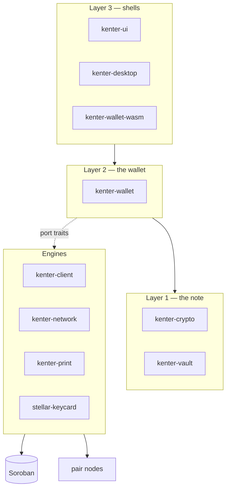

# System overview

A ship's anchor chain is made in lengths joined by a **kenter link**: a
connector the same shape and strength as the links beside it, and the only
one built to come apart. A Kenter note is a chain too. Each link is
contributed by a different pair of nodes, none of which sees the whole, and
the holder owns the link that opens: possession of the file is the authority
to take what the chain holds.

This page shows how the pieces fit. What the project is for is in
[What Kenter is](/).

## Three layers

Almost every question about the codebase is a question about which layer
something belongs in.



**Layer 1 is pure.** `kenter-crypto` defines the note container and the
cryptography; `kenter-vault` defines custody. Neither opens a socket or a
file. Both compile to `wasm32`.

**Layer 2 is the wallet core.** `kenter-wallet` knows what a holder owns, how
to reconcile it against the chain, and what the protocol requires before a
note may be received or spent. It reaches the outside world only through
**port traits** it defines. That is what lets one core serve a native desktop
client and a browser build.

**Layer 3 is shells and engines.** Everything that touches a socket, a disk,
a card reader or a window.

The rule that keeps this honest: **if `kenter-wallet` ever needs `tokio`,
`reqwest` or `std::fs`, the design has gone wrong.** Its `Cargo.toml` says so
in a comment.

## What a note is

A note is a file, conventionally `.symtoken`. It carries an **ephemeral
Stellar account** whose secret nobody ever held whole.

That secret is built *additively* from contributions by pairs of nodes. Each
pair adds a **chain link**; no node and no single pair ever sees the whole
secret. The depositor holds the first and last links, so the completed note
comes into existence on the holder's own machine and nowhere else. The note
also carries a random **claim key**, generated at that moment, which
redemption must sign with.

**Nobody chooses the nodes in between.** The depositor names only its own two
end pairs. A drand round published after the request seeds a draw, and
registered node pairs claim positions by a score anyone can compute and no
one can choose. The roles:

| Party | Does |
|---|---|
| Depositor | Escrows the value, names its two end pairs, carries the partial note to each selected pair, closes the chain, registers the note |
| drand quicknet | Publishes round `R`'s BLS signature. The mint verifies it; it never calls drand |
| Node pairs | Register as a pair once, claim positions, add a link when asked, confirm it on chain |
| Mint contract | Fixes the round at request, verifies the seed, scores claims, keeps the lowest, settles fees |

```mermaid
sequenceDiagram
  participant H as Depositor
  participant M as Mint contract
  participant D as drand
  participant P as Node pairs

  H->>M: request_print (escrow, end pairs; fixes round R)
  D-->>H: round R signature (once published)
  H->>M: seed_print (verified on chain; opens claim window)
  P->>M: claim_position (lowest scores win)
  H->>M: confirm_link 0
  H->>P: partial token, to each selected pair in turn
  P->>M: confirm_link
  P-->>H: + link
  H->>H: close the chain — the note exists only here
  H->>M: register_token (chain_hash, claim key)
```

A selected pair that does not serve is skipped for a runner-up, at a fee the
depositor pays. The whole mechanism is in [Node
selection](/architecture/node-selection); the note's life after printing is
in [Tokens and their lifecycle](/architecture/tokens).

Holding the file is holding the value. There is no balance record to consult
and no account to freeze.

## Two ways to redeem

The mint offers both. Each requires a proof of possession as well: the claim
signature for a pure-bearer note, the owner signature for a spend-mode note.

| | How it works | Trade-off |
|---|---|---|
| **Path A** — `redeem_by_key` | Collect shards from the pairs that printed it; reconstruct the ephemeral secret and sign | Needs the node network live and a combiner; the chain stays private |
| **Path B** — `redeem_by_chain` | Present the chain; the contract checks it against the registered commitment and verifies it | Offline and node-free; the chain becomes public |

**The desktop client uses Path B.** It needs only the note file and, in spend
mode, the owner key. No shard secrets are retained and no node is contacted.
Path A is in the contract and in `kenter-crypto`, but no client drives a
combiner.

## Pure bearer and spend mode

**Pure bearer.** Whoever holds the file can redeem it. Simple, and
irrecoverable if copied.

**Spend mode.** The mint's record carries an **owner commitment**. Redeeming
or transferring requires a signature from an owner key the holder derives from
their seed at `m/44'/148'/n'`. A stolen file alone is not enough. The
contract verifies with `ed25519_verify`, so the owner key is Ed25519.

See [Bearer and spend mode](/architecture/spend-mode).

## The contracts

Two Soroban contracts, in `contracts/`:

**`kenter-roster`** — the node registry. It gates relay access, records each
node's relay endpoint, and says whether an address is a selectable node and
on what terms (paid or volunteer). A node locks a bond to join and reclaims it
only after an unbonding delay, which is what makes a roster identity cost
something. It has no admin. It answers one address at a time and cannot list
its nodes, which is why nodes come to a print rather than being picked from a
list.

**`kenter-mint`** — escrow, print coordination and redemption. It has no
admin, no withdrawal entry point and no upgrade path; every parameter is
fixed at deploy.

Its entry points, grouped by purpose:

- *Printing* — `request_print`, `confirm_link`, `cancel_print`,
  `clear_expired_slot`, `is_slot_expired`, `get_slot`
- *Selection* — `seed_print`, `claim_position`, `skip_position`,
  `register_pair`, `unpair`, `pair_of`, `selection`
- *Registration* — `register_token`, `get_token`, `get_token_state`
- *Moving value* — `spend`, `redeem_by_key`, `redeem_by_key_owned`,
  `redeem_by_chain`, `redeem_by_chain_owned`, `is_redeemed`,
  `redeemed_at`
- *Node economics* — `claim_fees`, `accrued_fees`. A volunteer node's
  fees are burned instead of credited
- *Storage rent* — `bump`, `bump_token`. Neither takes auth: paying an
  entry's rent cannot harm anyone, and a bearer note has no address to
  authenticate from. See [Ledger costs](/LEDGER_COSTS)
- *Configuration* — `node_fee`, `min_pairs`, `max_pairs`, `pay_token`,
  `roster`, `max_print_ledgers`

The full interface, with arguments, auth and errors, is
`contracts/kenter-mint/API.md`.

## The network

There is no coordinator and no node with a special role. The mint, not any
node or relay, decides which pairs serve a print. A node keeps little state
beyond its pair's keys: it watches the mint for new slots and claims where
its score may win.

- **`kenter-tunnler`** — the relay. Nodes connect over WebSocket and
  authenticate with a Stellar-signed JWT; wallets reach nodes through its open
  HTTPS proxy route. It takes no part in selection.
- **`kenter-node`** — a pair node. Serves `/kenter/health`, `/kenter/shard`
  (Path A redemption) and `/kenter/extend` (printing). Its daemon registers
  the pair once, seeds slots it would claim, claims positions, and clears
  expired slots it confirmed on.
- **`kenter-network`** — the wire protocol and tunnel client both ends use.
- **`kenter-print`** — drives a print across live nodes. It is its own crate
  because the CLI and the GUI are sibling binaries that cannot reach into
  each other.

See [Network and contracts](/architecture/network).

## Custody

Custody is a trait, not a place. `kenter-vault` defines two:

- **`KeyVault`** — slot-based custody of Ed25519 Stellar account keys.
- **`DerivingVault`** — one seed, HD-derived owner keys for spend mode.

They are separate because the roles differ in lifetime and in what names a
key: a slot id versus a derivation index recorded on a held note.

Implementations: **`SoftVault`** (passphrase-encrypted at rest, in
`kenter-vault`) and the Keycard vault (hardware, in `stellar-keycard`). The
client depends on the traits, never on which one is in use.

See [Custody and keys](/architecture/custody). What each component trusts,
and what stops the main attacks, is in [Security
model](/architecture/security-model).
