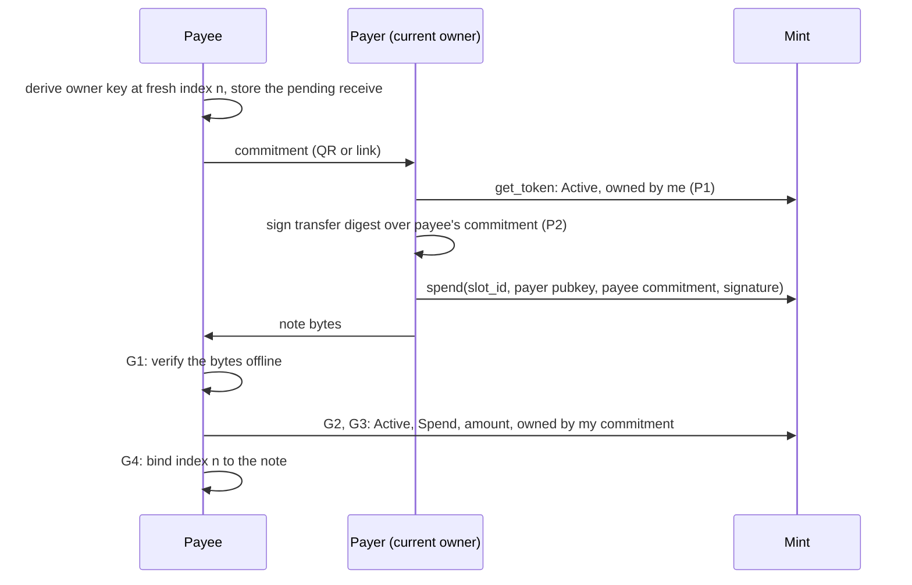

# Bearer and spend mode

Every note is registered in one of two modes, chosen per note at
`register_token`:

- **Pure bearer** — like cash. Whoever holds the file can redeem it. Handing
  it over leaves no trace on the ledger. If someone copies the file, they can
  redeem it first.
- **Spend mode** — like a registered instrument. Redeeming or transferring
  needs a signature from an **owner key** the current holder controls. A copy
  of the file alone is worthless. The cost is that every change of hands is a
  transaction on the ledger.

Neither mode hides the ends: the ledger always shows which account deposited
a note and which account received the payout. Pure bearer hides the path
between them.

The primitives are in `kenter_crypto::spend`. The wallet's side
(index allocation, the receive gates) is in `kenter-wallet`. The mint's side
is `spend`, `redeem_by_key_owned` and `redeem_by_chain_owned`.

## What each mode protects against

| | Pure bearer | Spend mode |
|---|---|---|
| Who can redeem | Whoever holds the file | Holder of the file **and** the current owner key |
| Payer keeps a copy after paying | Can race the payee to redeem | Cannot: after the transfer the payer is no longer the owner |
| Stolen or photographed file | Lost | Still needs the owner key |
| Lost owner key | — | Note cannot be spent or redeemed |
| Transfers on the ledger | None | One `spend` transaction per change of hands |
| Payee can confirm receipt | Only that the note exists and is live | That the ledger moved ownership to them |

Spend mode closes payer fraud: a payer who hands over the bytes and keeps a
copy cannot redeem it afterwards. Pure bearer cannot close that, because the
copy is as good as the original.

## Owner keys

The owner key is an Ed25519 key, separate from the note's ephemeral key and
from the holder's Stellar account. It is derived from the wallet seed:

```
owner key n = SLIP-0010-ed25519(seed, m/44'/148'/n')
```

The held note records the index `n` so the wallet can re-derive the key when
it needs to sign. The same path is used by software custody and on the card,
so a card can take over a software wallet's notes.

- **Fresh index per receipt.** One key across notes would link them all on
  the ledger through the commitment. Indices come from a monotonic counter
  and are never reused; an abandoned receive burns an index, which costs
  nothing.
- **Index 0 is the standing pay tag** (`STATIC_RECEIVE_INDEX`), an opt-in
  reusable receive address for payments made while the payee is absent.
  Everything sent to it is linkable to everything else sent to it. Fresh
  indices start at 1 (`FIRST_FRESH_INDEX`).
- **The index only moves forward** (`Store::advance_owner_index`), matching
  the card's own counter, so software and hardware behave the same.

SLIP-0010 Ed25519 is hardened-only, so there is no public-key-only
derivation: generating a receive commitment needs the seed, which means a
receive prompts for the passphrase or the card.

### The seed recovers authority, not value

Notes cannot be found from the seed. The ledger keys records by slot, and
nothing maps a commitment back to a note. A complete backup is therefore the
seed **and** the note files, and they have opposite cadences: the seed is
backed up once, the notes after every receipt. See
[Data formats](/architecture/data-formats) for the backup containers.

## Commitments

The ledger never stores an owner's public key while the note is held. It
stores a 32-byte commitment:

```
owner_commitment = SHA-256("kntr_v1:spend:owner" ‖ owner_pubkey)
```

A transfer or redemption reveals the current owner's public key, and the mint
checks that it opens the live commitment.

The token record carries `mode`, `owner_commitment` and a `spend_nonce`, the
count of transfers so far. A pure-bearer record ignores the commitment.

## What the owner signs

Owner authorizations sign **the SHA-256 digest of the message**, never the
message itself. The card's signing command takes a 32-byte input, and hashing
first makes card and software signatures interchangeable.

```text
transfer:  "kntr_v1:spend:auth"   ‖ contract_xdr ‖ slot_id (u32 BE) ‖ ephemeral_key
                                  ‖ current_commitment ‖ new_commitment
                                  ‖ spend_nonce (u32 BE)

redeem:    "kntr_v1:spend:redeem" ‖ contract_xdr ‖ slot_id (u32 BE) ‖ ephemeral_key
                                  ‖ owner_commitment ‖ spend_nonce (u32 BE)
                                  ‖ recipient_xdr
```

Each field is there for a reason:

| Field | Stops |
|---|---|
| `contract_xdr` (the mint's `Address` as XDR) | A signature made for one deployment being used against another holding escrow for the same key |
| `slot_id` | A signature made for one record verifying against another. The mint keys records by slot, and two records may name the same ephemeral key |
| Both commitments (transfer) | Replay against a moved state, and an observer swapping in a different successor |
| `spend_nonce` | Replay of an old transfer when a note returns to a commitment it held before, which happens with change and refunds sent to the static pay tag |
| `recipient_xdr` (redeem) | Redirection of the payout by anyone who sees the signature |

The wallet reads the nonce and the contract address from the ledger
immediately before signing, never from the caller.

These byte layouts are pinned in `tests/vectors/spend_vectors.json` at the
repository root, so the card applet can reproduce them exactly:

```sh
cargo test -p kenter-crypto --test spend_vectors
```

## Transfer



`spend(caller, slot_id, owner_pubkey, new_owner_commitment, signature)`
requires an active spend-mode record, checks that `owner_pubkey` opens the
live commitment, verifies the signature over the transfer digest, overwrites
the commitment with the successor's and increments `spend_nonce`. The
transaction's source account pays the fee; it does not authorize anything.
Ownership is the owner-key signature.

The bytes and the ownership pointer do not move atomically. The gates make
each half-state safe: if the pointer moved but no bytes arrived, the payee
withholds acceptance and the payer has only stranded their own note; if bytes
arrived but the pointer did not move, the payee withholds acceptance. Neither
leaves the honest party worse off.

## The receive gates

A conforming client must not show "payment received" until every gate for its
role passes. They are protocol, not preference: they live in `kenter-wallet`
so every shell enforces them identically.

**Payee**

- **G1 — Structure.** The bytes parse, every link's two signatures and the
  hash chain verify, and the links' partial keys sum to the note's ephemeral
  key. This proves the note was built correctly, not that it is live or
  owned.
- **G2 — Existence and value.** The mint's record is `Active`, in spend mode,
  with the amount the note claims.
- **G3 — Ownership.** The live `owner_commitment` equals the payee's own
  commitment, while still `Active`. The wallet keeps polling for this. This is
  the completion signal, and it is self-certifying: the mint moved the
  pointer only because the payer opened the previous commitment.
- **G4 — Persist the key.** The owner key must survive. With derived keys
  this reduces to recording the index, which the wallet does when it creates
  the pending receive, before showing the commitment. No owner key ever
  exists only in memory.

Offline acceptance is not supported: skipping G2 and G3 reduces to trusting
bytes.

**Payer**

- **P1** — confirm the note is active and owned by you before signing.
- **P2** — sign only over the payee's commitment.
- **P3** — treat the payment as complete only after the `spend` transaction
  succeeds. After that, you cannot redeem the note.
- **P4** — **a failed submission is not a cancelled payment.** The
  authorization stays valid until the note's nonce moves, and a broadcast
  transaction has published it whether or not it landed. Retry the same
  authorization rather than paying with a different note. To abandon it,
  spend the note to yourself (`current → current`), which advances the nonce.
  That remedy checks itself: if the original did land, the self-spend fails
  with `OwnerCommitmentMismatch`. The desktop client says this in its error
  message; it does not yet persist a pending payment.

### A note the wallet already knows

In two cases the ledger, not the wallet's own records, says what to do:

- **Paid away and paid back.** A note can return as change, as a refund, or
  because the payee pays you. Once G2 and G3 show the ledger says it is yours
  again, at an index this wallet owns, the stored record is replaced.
- **Two containers, one id.** The claim key is generated at assembly, so the
  same print assembled twice yields two containers that agree everywhere
  structure is checked and differ in who can redeem. Identical bytes are a
  duplicate. Different bytes go to the ledger, which knows which chain and
  claim key were registered, and the copy it describes wins. If the ledger
  cannot answer, nothing is evicted.

### What the gates rest on

G2 and G3 are reads from one Soroban RPC endpoint, which serves state, not
proofs. A payee who passes them has verified the note against **their
endpoint**, not against the network. See
[Security model](/architecture/security-model) for what the client checks
and what it cannot.

## Redemption

Both of the mint's redemption entry points have spend-mode forms. Kenter's
clients use the by-chain ones; nodes do not serve the shards the by-key ones
need.

| Mode | By chain | By key |
|---|---|---|
| Pure bearer | `redeem_by_chain`: chain preimage + claim signature | `redeem_by_key`: ephemeral-key signature + claim signature |
| Spend mode | `redeem_by_chain_owned`: chain preimage + owner proof | `redeem_by_key_owned`: ephemeral-key signature + owner proof |

The mint enforces the mode in both directions: a spend-mode note refuses the
plain paths (`SpendModeRequiresOwner`), and a pure-bearer note refuses an
owner proof (`NotSpendMode`). So the "cannot redeem after paying" rule is
enforced by the immutable contract, not by node honesty.

In spend mode the owner proof replaces the claim signature. It is already
bound to the recipient, so a failed redemption transaction leaves nothing on
the ledger anyone else can reuse.

Redemption by chain needs no nodes, so a verified owner can always redeem regardless of
whether the network is up. See [Tokens and their lifecycle](/architecture/tokens).

## Node collusion

Spend mode is not exposed to node collusion at all. Even if every interior
pair colluded and reconstructed the ephemeral secret, redemption still needs
a signature from the owner key, which is derived from the holder's seed and
never reaches a node. Pure bearer is protected by a different property: the
holder's own closing link. Both are explained in
[Security model](/architecture/security-model).
