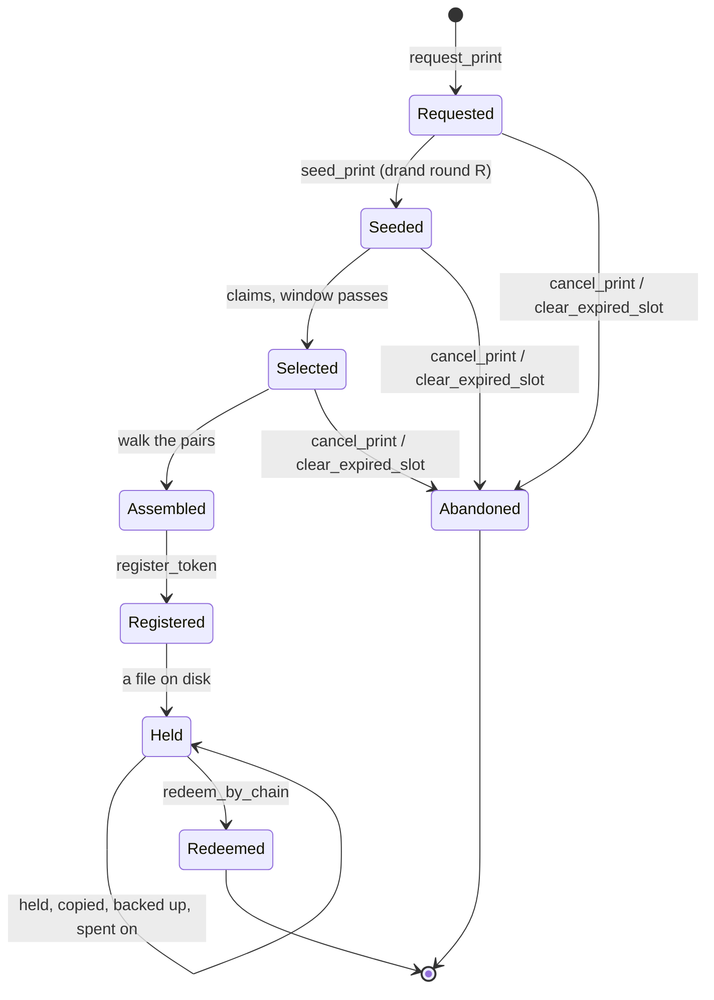

# Tokens and their lifecycle

A note's life has four stages, and most of the code is organised around
them.



## 1. Printing

A print has `total_pairs` links, numbered `0..total_pairs`. Links `0` and
`total_pairs − 1` are the depositor's own; everything between is an
**interior pair** of two distinct roster nodes. `min_pairs` is at least 3, so
every print has at least one interior pair. Write `k = total_pairs − 2` for
the number of interior positions.

**The depositor does not choose the interior pairs.** In outline:

1. **Request.** `request_print` names the amount, `total_pairs` and the
   depositor's own two end pairs, and nothing else. The mint escrows the
   amount and fixes a drand round `R` that has not been published yet.
2. **Seed.** Once round `R` is out, anyone posts its signature with
   `seed_print`. The mint verifies it on chain and derives the slot's seed.
3. **Claim.** Registered node pairs score themselves and call
   `claim_position`. The mint keeps the lowest `2k` scores: `k` winners and
   one runner-up per position.
4. **Walk.** After the claim window, the depositor's client confirms link 0,
   then carries the partial token to each selected pair through the relay.
   Each pair adds a **chain link** and calls `confirm_link` itself, so the
   contract learns of each link from the node that made it.
5. **Skip.** A selected pair that does not confirm within `serve_timeout` is
   replaced by the best runner-up, at a burned fee the depositor pays.
6. **Close.** The depositor builds the last link from its own pair, assembles
   the note and generates its claim key.

Every step, with its checks, timings and costs, is in [Node
selection](/architecture/node-selection).

The depositor's own machine makes the last link, so **the completed note
first exists on the holder's machine and nowhere else**. No node and no
single pair ever saw enough to reconstruct it. The depositor's client checks
every extension before the next pair sees it.

`kenter-print` drives the depositor's side (`print_selected`).
`kenter-node` (`select.rs`) registers the pair, seeds and claims;
`kenter-network`'s `/kenter/extend` handler is where a pair adds its link.

### What the depositor pays

| | |
|---|---|
| Escrow | The note's face value, held by the mint until redemption. Must exceed `2 · node_fee · k` |
| Node fees | `node_fee` per interior participant (two per interior pair), taken from the escrow at redemption. End pairs are neither charged nor credited |
| Skips | `2 · node_fee` per `skip_position`, paid by the depositor at the time and burned. Not from the escrow, so the escrow stays equal to the note's face |
| Abandoning | `node_fee` to each confirmer of an interior link, plus `2 · node_fee` burned per unconfirmed interior position once a draw exists. The exceptions are in [Node selection](/architecture/node-selection#cancellation-expiry-and-refunds) |
| Transactions | `request_print`, usually `seed_print`, one `confirm_link` per end link, `register_token` |

A volunteer node's fees are burned rather than credited; the holder's payout
is the same either way.

## 2. Registration

`register_token(caller, slot_id, ephemeral_key, chain_hash, mode,
initial_owner_commitment, claim_pubkey)` records the note. The depositor
calls it once every link is confirmed and before the slot expires. It
commits two things:

- **`chain_hash`** = SHA-256 of the note's canonical chain data, computed by
  `kenter_crypto::chain_data::chain_hash`. Path B redemption must present a
  chain that hashes to it. Without that commitment, a chain could be built
  from public data alone (the ephemeral key, event id and pair count are all
  public) and the escrow drained by someone who never held the note.
- **`claim_pubkey`**, the public half of the note's claim key. Redemption of
  a pure-bearer note must carry a signature from it.

The record is keyed by `slot_id`, which the contract issues, and each slot
holds one record, ever. The ephemeral key is a value the depositor names and
is public before registration, so it cannot be the key.

Registration also retires the print slot: both its entries are deleted. The
participant list and volunteer bits the note needs are copied into the token
record. Observers wanting the partial keys read them from
`LinkConfirmedEvent`.

## 3. Held

The note is a file. The wallet records it as a `HeldToken` with:

- the container bytes;
- its id, `<ephemeral address>-<slot_id>` (`kenter_wallet::models::note_id`),
  derived from the bytes, not assigned. Either half alone can collide: the
  slot is what the mint keys by, the address is what a person recognises;
- an `ExportLog`: every time the bytes left the wallet, and how;
- an owner index, if it is a spend-mode note.

`backup::check` re-derives the id on restore, so a note whose id does not
match its bytes is rejected rather than imported.

### A held note has a storage life

The mint's record of a note is a ledger entry, and Soroban charges rent for
it. `register_token` leaves the record with a floor of 7 days. Beyond that,
how long it stays current is the holder's choice:

```
bump_token(slot_id, ledgers)
```

Anyone may call it, since there is no address on a bearer note to
authenticate. Asking for less life than the record already has does nothing,
so a wallet can call it on a schedule without bookkeeping. It carries the
contract's own entries along with the note's, because a live record inside an
archived contract is not redeemable.

**A note whose record has archived is still redeemable.** Soroban restores an
archived persistent entry automatically when a transaction names it. What
rent buys is predictability: without it, the restore fee falls on whoever
next touches the record, which is the holder at redemption. See [Ledger
costs](/LEDGER_COSTS) for the figures.

### Reconciliation

The wallet's view and the chain's can differ. `reconcile()` pairs them into
`ReconciledToken`, and `trusted_amount()` reports what can be relied on.
Disagreement is surfaced as **disputed** rather than averaged away: a note
the chain says is redeemed must not quietly count toward a balance.

Reading a redeemed note takes two lookups. Redemption removes the token
record and writes a `Redeemed(slot_id)` marker, so a client that reads only
`Token(slot_id)` cannot tell a redeemed note from one that never existed.
The client reads both keys and treats a present marker as `Redeemed`.

### Export is logged

Every path that moves bytes out records an `ExportKind`. For a bearer
instrument, a copy is a potential loss of exclusivity, and a holder deserves
to know how many ways a note has left their machine.

## 4. Spending and redeeming

**Redeem (Path B)** — `redeem_by_chain` / `redeem_by_chain_owned`. The
desktop client uses this: offline, node-free, needing only the note file and,
in spend mode, the owner key. The chain becomes public.

**Spend** — `spend` moves a spend-mode note to a new owner without redeeming
it. See [Bearer and spend mode](/architecture/spend-mode).

**Redeem (Path A)** — `redeem_by_key` reconstructs the ephemeral secret from
shards collected from the printing pairs. The chain stays private, but it
needs the network live and a combiner. No client drives it.

Every redemption also proves possession of the note:

| Mode | Proof | Digest signed |
|---|---|---|
| Pure bearer | Claim signature, from the claim secret in the file | `SHA-256("kntr_v1:redeem:claim" ‖ contract ‖ slot_id ‖ ephemeral_key ‖ recipient)` |
| Spend mode | Owner signature, from the owner key | See [Bearer and spend mode](/architecture/spend-mode#what-the-owner-signs) |

The recipient is in both digests, so a signature left in a failed transaction
is useless to anyone else. This is what makes Path B safe: presenting the
chain publishes it, and a failed transaction publishes it while the note
stays live, but the chain alone does not redeem.

Redemption pays `amount` minus the interior node fees to a `recipient` the
holder names. The recipient is not authenticated (the paying side is the
contract, and an address cannot be harmed by being sent an asset it already
trusts), but it may not be the mint itself, which would consume the note and
strand the escrow.

What remains afterwards is a `Redeemed(slot_id)` marker holding the ledger
the payout happened on. It is not kept alive: on-chain reads restore it, so a
second redemption is refused permanently, while `is_redeemed` is an
off-ledger convenience that lapses once the marker archives. Slot ids are
never reused, so the record's absence alone refuses a second attempt; the
marker lets the contract say `AlreadyRedeemed` rather than `TokenNotFound`.

::: warning Redemption pays into the fee-paying account
That account is BIP-85 child index 3, derived from the seed, so the proceeds
of a redeemed note are recoverable from the recovery phrase alone. See
[Custody](/architecture/custody).
:::

## Pure bearer and spend mode

| | Pure bearer | Spend mode |
|---|---|---|
| Who can redeem | Whoever holds the file | Holder of the file **and** the owner key |
| On the ledger record | Nothing extra | An owner commitment and a transfer nonce |
| Key | — | `m/44'/148'/n'`, Ed25519 |
| If copied | Gone | Still needs the key |

Spend mode adds gates the client must honour: the receive gates G1–G4 and the
payer rules P1–P4. They are **protocol, not preference**: a client that skips
a gate accepts notes it should refuse. They live in `kenter-wallet` so every
shell enforces them identically. See [Bearer and spend
mode](/architecture/spend-mode#the-receive-gates).

### What the gates rest on

G2 and G3 are ledger reads. The client asks one Soroban RPC endpoint what the
mint recorded and acts on the answer. Soroban RPC serves state, not proofs,
so **a payee who passes G2 and G3 has verified the note against their RPC,
not against the network.**

What the client does about it:

- **The answer must be about the question.** Every direct ledger read checks
  that the entry returned carries the mint's own contract address and the
  exact `DataKey` that was asked for. Otherwise an endpoint could answer a
  question about one note with another note's record, or with an entry from
  a different contract that happened to decode.
- **Unreadable means refused.** A record whose `mode` discriminant is
  unrecognised is an error, not a fallback to `PureBearer`, the mode with no
  owner check.
- **Absent means asked again.** A missing `Token` entry may mean the note was
  redeemed, that the record archived, or that it never existed. The client
  reads the `Redeemed` marker and, failing that, simulates
  `get_token_state`, which restores archived entries and is authoritative.
- **No plaintext hop.** A non-loopback `http://` endpoint is refused unless
  the caller opts in explicitly in source. Loopback is allowed: it is how a
  local quickstart is reached.
- **A fee ceiling.** The resource fee comes from the endpoint's own
  simulation and is capped before signing.
- **The source is on screen.** The receive page shows which endpoint the
  gates ask, under "checked against".

None of this makes a dishonest endpoint honest. It can still claim a note
does not exist, serve a stale record, or fabricate a live one that names the
right contract and key, carries this note's chain hash and passes every gate.
The remedy is to point the client at an endpoint you run. Cross-checking two
endpoints adds latency without raising the bar while both come from the same
configuration.

## Owner indices

| Index | Meaning |
|---|---|
| 0 (`STATIC_RECEIVE_INDEX`) | The standing pay tag |
| 1+ (`FIRST_FRESH_INDEX`) | Fresh per-note indices |

`Store::advance_owner_index(to)` is **forward-only**, mirroring the card's
own index counter so software and hardware behave identically. Reusing an
index links two notes to one key, which is exactly what fresh indices
prevent.

## Counterfeits

A fabricated note can be made to look structurally plausible, so restore
does not take a backup at its word. `backup::check` parses it, verifies chain
integrity, and confirms the id derives from the bytes. A note failing any of
these is **rejected rather than imported**, and `RestoreReport` reports it.

The `testing` feature provides a `fabricated` fixture so these paths are
exercised.
