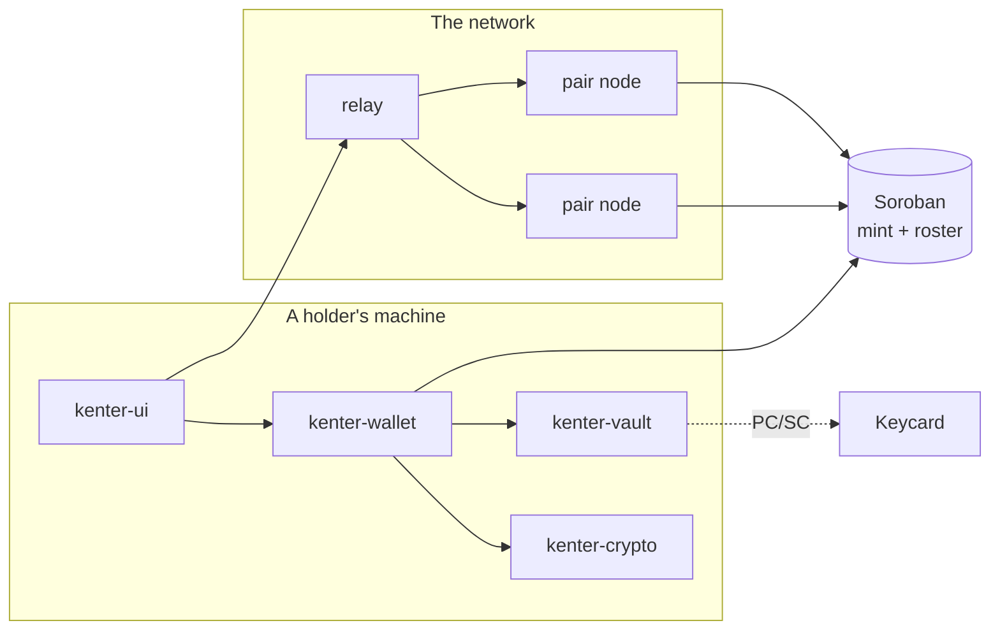

# Kenter

Kenter is a **non-custodial bearer-note wallet** on Stellar/Soroban.

A Kenter note is a file. Holding the file is holding the value: there is no
account balance behind it and no server that can freeze it. The chain is used
to *mint* notes and to *redeem* them, not to hold them. In between, a note
lives on your disk, on a card in your pocket, or on a sheet of paper in a
drawer.

The design goal is **non-custodial** in the strict sense: nobody holds a
holder's value on their behalf. Not the network, not the contract authors,
not an operator. The mint contract has no admin, no withdrawal entry point
and no upgrade path, so there is no party able to withdraw or redirect
escrowed funds.

Taking away the custodian takes away the recourse with it. That drives most
of the architecture, and most of the difficulty:

- **Loss is final.** There is no "forgot password" and no support desk.
  Backup and restore are not a feature; they are the product working at all.
- **Possession is authority.** Anything that can read a note can spend it, so
  every path that moves bytes out of the wallet is a path that can move
  money.
- **The client is the system.** Verification, custody and policy live in the
  client, because there is no trusted server to put them on.

## The shape of it

A note is **minted** by walking a partial token around a set of node pairs,
each contributing a signed link to a chain. Nobody picks those nodes: the
depositor names only its own two end pairs, a future drand round seeds the
print, registered pairs claim the positions between, and the lowest scores
win ([Node selection](/architecture/node-selection)). It is **held** as a
file by its owner. It is **redeemed** against the mint, by presenting the
chain (Path B, no nodes involved) or by collecting shards from the same pairs
(Path A), which releases the underlying asset.

## What is built

Kenter is pre-release. Nothing is deployed to mainnet and there are no users,
so formats carry no backwards-compatibility constraints: if a format is
wrong, change it.

| Area | State |
|---|---|
| Note format, crypto | Built and tested |
| Soroban contracts (mint, roster) | Deployed on testnet |
| Node selection (drand-seeded draw) | Built; running on testnet |
| Desktop client (`kenter-ui`) | Built; the primary surface |
| Path B redemption | Built, used by the client |
| Path A redemption | In the contract and `kenter-crypto`; no client drives it |
| Keycard custody | Working on real hardware |
| Backup and restore (file) | Built, exercised on hardware end to end |
| Backup and restore (paper) | Built; optical path proven, see [Paper](/testing/paper) |
| Browser / mobile | Spike only (`kenter-wallet-wasm`) |

## Where to go next

- **[Reading guide](/reading-guide)**: the order to read this in, depending
  on what you are trying to do.
- **[System overview](/architecture/overview)**: how the pieces fit.
- **[Security model](/architecture/security-model)**: what each component
  trusts, and what stops the main attacks.
- **[Setting up](/runbook/setup)**: get it building and running.
