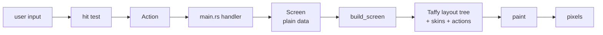

# `kenter-ui`

The desktop client, and by a wide margin the largest crate. It is also the
one most worth understanding structurally before you touch it, because its
architecture is unusual. The public items are listed in
`crates/kenter-ui/API.md`.

## The idea: screens are data

There is no retained widget tree and no callbacks. A **`Screen`** is a plain
enum of view structs. Building a screen turns that data into a layout tree
plus a list of actions. Painting turns the layout into pixels.



The consequence that matters: **screens are testable without a window.**
Build a view, assert on the text it contains and the actions it offers. That
is how the unit tests in `src/` cover behaviour like "a restore that only half worked
must still offer a way forward" — states that are hard to reach by hand.

```rust
let ui = Ui::build_screen(&screen);
assert!(actions_on(&ui).contains(&Action::RestoreScanned));
assert!(text_on(&ui).contains("Restore what I have"));
```

If you add a screen state, add a test like that. It is the cheapest
regression net in the codebase.

## The stack

| Layer | Crate |
|---|---|
| Window and input | `winit` 0.30 |
| Pixel surface | `softbuffer` |
| Layout | `taffy` (flexbox) |
| Appearance | `pelt` — SVG "skins" rasterised via `usvg`/`resvg` |

Skins live in `crates/kenter-ui/skins/kenter/*.svg`. An artist edits the SVG;
code references states and tokens inside it. Rasterised results are cached by
`(node, layer, state, size, content hash)`, so a hover re-renders one element
rather than the scene.

## Modules

| File | Holds |
|---|---|
| `lib.rs` | `Screen`, every view struct, `build_screen`, painting, the screen tests |
| `main.rs` | The shell: event loop, action handlers, worker threads |
| `receive.rs` | The receive flow; `UiEvent` |
| `wallet.rs` | `Network`, wallet paths, loading a `WalletView` |
| `vault.rs` | `GuiVault`: software or card custody behind one `DerivingVault` |
| `setup.rs` | First run |
| `card.rs` / `card_setup.rs` | Keycard readiness, PIN rules, provisioning |
| `deposit.rs` | Deposit and printing |
| `pay.rs` | Handing a note over, spend-mode transfer |
| `redemption.rs` | Redeeming |
| `account.rs` | The Stellar account, stalled prints, cancel |
| `settings.rs` | Settings page data |
| `backup.rs` | Backup working copy, atomic writes, restore |
| `reset.rs` | Resetting a wallet that cannot be opened |
| `sheet.rs` | Paper page geometry and SVG |
| `pdf.rs` | A hand-written PDF emitter |
| `qr.rs` | QR rendering to SVG |
| `scan.rs` | Reading QR out of images |
| `camera.rs` | Capture thread, frame events |
| `mock.rs` | Fabricated data for `kenter-ui-mock` |

## `Screen`

| Variant | Notes |
|---|---|
| `Wallet` | The billfold |
| `Receive` | |
| `Settings` | |
| `Account` | |
| `Deposit` | |
| `Pay` | |
| `Redeem` | |
| `Setup` | First run. **No nav** — nothing else is reachable yet |
| `Locked` | Store sealed. No nav, for the same reason |
| `Reset` | Resetting a wallet that cannot be opened. Reached only from `Locked` |
| `Paper` | Paper backup and restore |
| `Prompt` | An authorization prompt, over whichever page asked |

`Paper` is its own screen rather than a mode of Settings because its import
half has a state nothing else here does: **partial success as the normal
case.** Every other flow worked or did not; a scan gives you three notes of
four, and that is a result to act on rather than an error to dismiss.

## Paper and camera

| Module | Role |
|---|---|
| `sheet` | Page geometry. `layout()`, `pages()` (SVG), `slots()`, `module_mm()` |
| `pdf` | `render(chunks, fingerprint, created)` — a hand-written PDF 1.4 emitter with Flate streams |
| `qr` | `svg_bytes(data, dark, light, ec, quiet)` |
| `scan` | `read_luma`, `read_dynamic`, `read_image`, `read_all`, `read_frame`, `read_page`; `Found`; `WANTED_WIDTH` |
| `camera` | `Capture`, `Event`, `cameras()`, `remembered()`, `pixels_per_module()`, `good_enough()` |

::: warning `scan` runs two QR readers and merges
`rqrr` and `rxing` have complementary, measured failure modes — see
[Paper and camera](/testing/paper). Do not remove one without re-running the
bake-off.
:::

::: danger Decode the capture frame, never the preview
`camera` sends a 480px preview for display and decodes at full sensor
resolution. Reading the preview instead silently halves what the decoder
sees, and a frame that is soft at full size still looks clean when scaled
down — so the mistake does not announce itself.
:::

Geometry notes: a symbol is 185 modules at 0.30 mm (`KENTER_PAPER_MODULE_MM`
overrides). `SYMBOL_MODULES` is shared with `camera` so the pixels-per-module
budget cannot drift from the page it describes.

::: tip `shape-rendering="crispEdges"` is load-bearing
Inlining a QR's SVG drops its opening tag, and with it that attribute. Without
it the renderer antialiases module edges into grey and a page that looks
perfect decodes about half its symbols at any resolution. `sheet.rs` reapplies
it on the group.
:::

## The shell (`main.rs`)

The event loop owns everything mutable: the current `Screen`, worker
threads, the camera handle, the scanned `Sheet`.

- Work happens on threads and reports back as `UiEvent` through an
  `EventLoopProxy`.
- Animation is frame-paced only while a page says it animates
  (`has_animation()`), so an idle client is idle.
- `show(screen)` is the single place a screen changes — which is where the
  camera is released when the holder leaves the paper flow, so no exit has to
  remember to.

## Binaries and examples

| Binary | Purpose |
|---|---|
| `kenter-ui` | The client |
| `kenter-ui-mock` | Every screen against fabricated data. No wallet, no chain, no card |

Examples are listed in [Build and run](/runbook/build-and-run#examples);
the paper ones are explained in [Paper and camera](/testing/paper).

## Tests

| Kind | Where |
|---|---|
| Screen and unit tests | inline in `src/` |
| `backup_recovery.rs` | Backup and restore |
| `card_ceremony.rs` | **Destructive, double-gated** (`#[ignore]` and `KENTER_CARD_DESTRUCTIVE=1`). Card provisioning |
| `replacement_card.rs` | **Destructive, double-gated.** Restore onto a new card |
