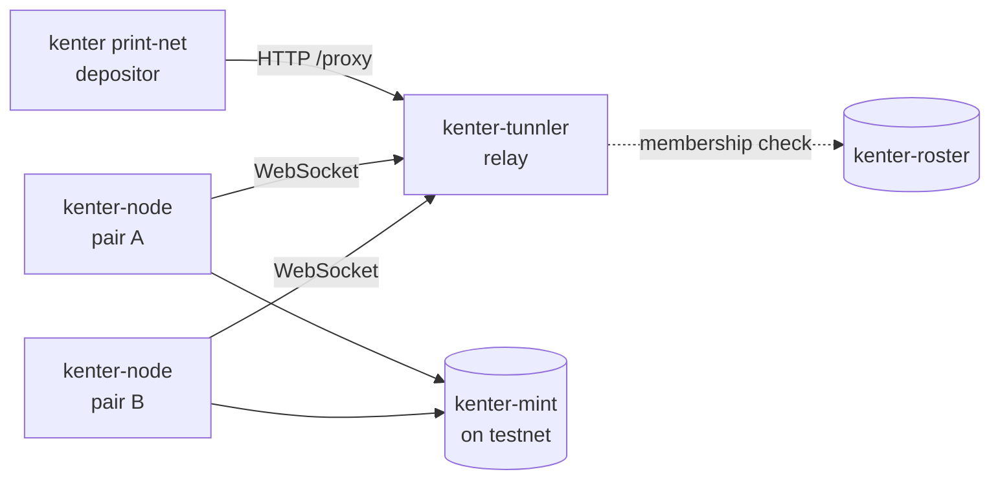

# A local network

A print needs a relay, pair nodes on the roster, and the mint on testnet.
This page brings a relay and nodes up by hand on one machine. For the guided
version, which also checks the ledger after each step, use
[`kenter-systest`](/testing/systest).



Nodes connect out to the relay. The depositor reaches each node with a plain
HTTP request to the relay's `/proxy/<node address>/<path>` route, which the
relay forwards down that node's WebSocket.

## 1. The relay

```bash
TUNNLER_SERVER_SECRET=S... TUNNLER_HOST=127.0.0.1 TUNNLER_PORT=8000 cargo run -p kenter-tunnler
```

The relay also reads these from `.env` ([Setting up](/runbook/setup#env)).
`TUNNLER_SERVER_SECRET` is any fresh Stellar seed; it is the relay's
identity.

With `ROSTER_CONTRACT_ID` unset, roster gating is off and any key can
connect. With it set, the relay checks the **on-chain roster** before
admitting a node: a node whose address is not registered authenticates and
is then refused with `not on roster`.

Production deployment is covered in [Deployment](/DEPLOY#the-relay-kenter-tunnler).
The wire protocol is in [Relay API](/tunnler-api).

## 2. The nodes

One `kenter-node` process serves one **pair**: two Stellar identities that
dual-sign every link the pair adds to a chain. The development form takes
both secrets from the environment:

```bash
KENTER_NODE_SECRET=S... \
KENTER_NODE_PARTNER_SECRET=S... \
cargo run -p kenter-node -- --tunnel 127.0.0.1:8000 --insecure
```

`--insecure` uses `ws://` instead of `wss://`. **Local development only.**
`--secret-file` and `--partner-secret-file` read the secrets from files
instead. `kenter-node --help-legacy` lists every flag of this form.

On start, the node joins the roster with both addresses if they are not on
it yet, registers its pair with the mint, and binds to the relay. Joining
stakes `min_stake` (150 XLM) per address, so each account needs that much
plus fees; friendbot's 10,000 testnet XLM covers it
([Testnet environment](/TESTNET)). `--no-roster` skips the roster entirely,
for testing the transport alone.

The installed form keeps its keys in a home directory instead:

```bash
cargo run -p kenter-node -- init --relay 127.0.0.1:8000
cargo run -p kenter-node -- addresses     # the two addresses to fund
cargo run -p kenter-node -- run
```

A relay on `127.0.0.1`, `localhost` or `[::1]` gets plain `ws://`
automatically. Set `KENTER_NODE_HOME` to keep several installs apart.

A node serves three endpoints:

| Endpoint | Purpose |
|---|---|
| `/kenter/health` | Liveness; reports the pair's two addresses |
| `/kenter/extend` | Printing: extends a partial token with one dual-signed link, then records the link on-chain with `confirm_link` |
| `/kenter/shard` | Redemption through nodes: re-derives this pair's shard by ECDH against the partner key carried in the `ChainLink` |

A print opens and closes with the depositor's own pairs, whose keys never
leave the depositor's machine. That is what keeps a note out of reach of any
coalition of nodes.

## 3. Print a note through it

A wallet reaches nodes only through the relays built into its release
(`Profile::relays` in `crates/kenter-client/src/network.rs`). It will not
use a local relay. Print from the CLI instead, which can send every request
through one relay:

```bash
cargo run -p kenter-desktop --bin kenter -- print-net \
  --secret-file depositor.secret --out note.symtoken --pairs 3 \
  --relay 127.0.0.1:8000 --insecure
```

`--pairs 3` is one pair chosen by the network between the depositor's two
end pairs. The mint and roster come from the build's testnet profile, or
from `KENTER_MINT` / `KENTER_ROSTER`.

The network chooses the interior pairs by a drand-seeded draw over every
pair registered with the mint ([Node selection](/architecture/node-selection)).
On a shared testnet roster the draw can pick other operators' pairs, which
are not connected to your relay. The system test handles this; for a
self-contained run, use `kenter-systest --skip-test`, which starts a local
relay and three nodes and prints through them.

## 4. Funding

Printing escrows value, so the depositor needs XLM for fees, a trustline for
the mint's asset (USDC), and a USDC balance.

For a wallet made in the GUI, one command does it, run twice with a click in
between:

```bash
export KENTER_SYSTEST_FUNDER_SECRET=$(stellar keys show testnet-deployer)
cargo run -p kenter-systest -- --fund G... --amount 5
```

The first run sends XLM. The wallet then adds the trustline itself, and the
second run sends USDC. See [Testnet environment](/TESTNET) for why the order
is forced, and for friendbot, the USDC issuer, trustline commands and the
current contract ids.

## Common failures

**Node authenticates, then disconnects.** Roster gating is on and its
address is not on the roster. Check the relay's `ROSTER_CONTRACT_ID` is the
roster the node joined, and that the node's accounts were funded well enough
to join.

**A print stalls on one position.** The selected pair is not connected to
the relay the print goes through. A selected pair that stays silent past the
serve timeout is skipped for the runner-up.

**"Insufficient balance" on an account that has funds.** The trustline for
the asset is missing, or the funds are XLM when the mint wants USDC.

**Nodes are up but never selected.** Check the node registered its pair with
the same mint the print uses (`KENTER_MINT`, or the build's default).

## Secrets

Every secret here comes from the environment or a file. **Never argv**: it is
visible to every process on the machine and persists in shell history.
`.env` is gitignored and must stay so.
