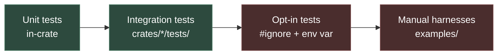

# The harnesses

Kenter's tests come in four tiers, and the thing to understand first is
**which ones run by default and which must be asked for**. Several of the
opt-in ones can destroy a card or spend real testnet value.



Green runs on `cargo test`. Red does not, and should not, without you
deciding to.

## Tier 1 — unit tests

In-crate, no external anything. `cargo test --workspace` runs them.

The largest concentration is in `kenter-ui`, which tests **screens as
data**: a view is built, and assertions are made about what it says and which
actions it offers. No window is opened. This is why screen behaviour — "a
restore that only half worked must still offer a way forward" — can be tested
at all.

`kenter-crypto`, `kenter-wallet` and `kenter-vault` carry the format and
protocol tests. These are the ones that catch the dangerous bugs; see
[Data formats](/architecture/data-formats) for the format rules they
enforce.

## Tier 2 — integration tests

In `crates/*/tests/`, run by `cargo test --workspace`.

| Test | Crate | What it covers |
|---|---|---|
| `bearer_token.rs` | `kenter-crypto` | Token round-trip |
| `cross_language.rs` | `kenter-crypto` | Compatibility with the other implementation |
| `spend_vectors.rs` | `kenter-crypto` | Golden vectors for spend mode |
| `owner_key_vectors.rs` | `kenter-vault` | Golden vectors for owner key derivation |
| `vectors_recipient.rs` | `kenter-client` | Recipient-side vectors |
| `wallet_core.rs` | `kenter-wallet` | The wallet core end to end |
| `full_lifecycle.rs` | `kenter-network` | Protocol lifecycle |
| `backup_recovery.rs` | `kenter-ui` | Backup and restore |
| `card_ceremony.rs` | `kenter-ui` | **Opt-in.** Full card provisioning |
| `replacement_card.rs` | `kenter-ui` | **Opt-in.** Restore onto a replacement card |
| `on_metal.rs`, `owner_keys.rs`, `provisioning.rs` | `stellar-keycard` | **Opt-in.** Real hardware |

### Golden vectors

Several suites compare against committed vectors. `KENTER_BLESS_VECTORS=1`
rewrites them.

::: warning Blessing vectors accepts whatever the code currently does
That is the point of them, so only bless when you have *checked* that the new
output is correct — never to make a red suite green.
:::

## Tier 3 — opt-in tests

Gated by `#[ignore]`, and the dangerous ones gated **twice**: `#[ignore]` plus
an environment variable, so neither `cargo test` nor `cargo test -- --ignored`
can fire them by accident.

| Gate | Needs |
|---|---|
| `#[ignore = "network"]` | A live network and funded accounts |
| `#[ignore = "needs a seeded fork Keycard…"]` | Real hardware on a reader |
| `#[ignore = "needs the applet's jcardsim SimServer…"]` | The simulator on `127.0.0.1:21345` |
| `KENTER_CARD_DESTRUCTIVE=1` | **Will wipe a card** |

See [Keycard hardware](/testing/keycard) before running any of these.

## Tier 4 — manual harnesses

Examples that need a human: a camera to point, a sheet to hold, a window to
look at. They are not tests — they take measurements.

The paper and camera work is almost entirely here, because the thing being
measured is optical and no unit test can reach it. See
[Paper and camera](/testing/paper).

The end-to-end test against testnet, `kenter-systest`, is also here: it
automates provisioning and assertions but pauses for an operator at each
step in the GUI. See [System tests](/testing/systest).

## Running them

```bash
cargo test --workspace                 # tiers 1 and 2
cargo test -p kenter-ui --lib          # just one crate's unit tests
cargo test -p kenter-wallet --lib paper  # just the paper tests
```

On a memory-constrained machine add `-j 2`. Do **not** reach for
`CARGO_PROFILE_TEST_DEBUG=0`: it changes the profile, invalidates every cached
artifact, and rebuilds the world.

More in [Running the tests](/runbook/testing).

## What is not tested

Worth knowing, so you do not assume coverage that is not there.

- **No GUI automation.** There are no hooks to drive the window, and
  `kenter-systest` says explicitly that inventing some would mostly test the
  hooks. It stops and tells an operator what to click.
- **Camera and print are manual.** No automated test points a lens at paper.
- **Only Windows has run the camera.** Linux and macOS resolve dependencies
  and nothing more.
