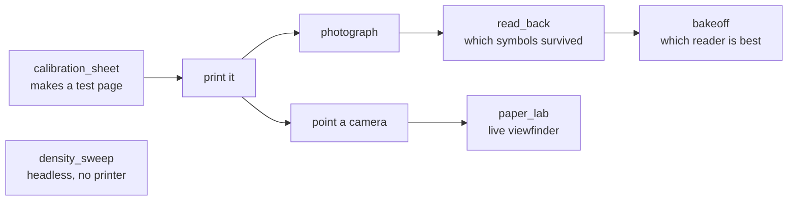

# Paper and camera

Paper backup is the most heavily measured part of Kenter, because its
failure is silent and delayed: a sheet that cannot be read looks exactly like
a sheet that can, until someone needs it.

Unit tests alone cannot cover it. Ink, printers, lenses and lighting are
outside the program, so most of this work uses manual tools that take
measurements.

## The tools



All are examples in `crates/kenter-ui/examples/`.

| Tool | Needs | Answers |
|---|---|---|
| `calibration_sheet` | nothing | makes a page of symbols at descending densities |
| `read_back` | images | which symbols a capture chain recovered |
| `paper_lab` | a camera | live viewfinder; which symbols land, at what frame rate |
| `bakeoff` | images | which QR reader performs best on the same pixels |
| `density_sweep` | nothing | which densities survive which resolutions, rasterised |
| `camera_probe` | a camera | the formats a camera offers and the pixels per module each gives |

`paper_lab` is the one to reach for. It is deliberately **not an
application**: one window showing the preview, everything else on the
console, no wallet, no key, no PIN.

```bash
cargo run -p kenter-ui --example paper_lab
```

- **Space** switches camera, and remembers the choice in `~/.kenter-camera`
- **S** saves the current frame at full resolution
- A strip along the bottom lights a cell per item as it reads
- The picture flashes green on a successful read

If you have no printer, display the sheet on a phone and read it with the
webcam. A screen is a harder target than paper (see "Pitfalls"), so results
from a screen are a floor.

## The arithmetic that governs everything

When a symbol fills the frame, **physical module size cancels out**:

```
pixels per module = frame pixels (short side) × fill / modules per symbol
```

A symbol is `modules × module_mm` across, so framing it puts exactly
`modules` modules on the sensor whatever the millimetres are. The 0.30 mm
module governs *printing*; the **QR version** governs whether a camera can
read it.

The floor is about **4 pixels per module**. Three is the decoder's hard limit;
four is where it still reads with a hand-held page and imperfect light.

## Measured figures

The figures below come from a 1920x1440 webcam delivering raw NV12, a
reasonable mid-range baseline. Re-run the tools on your own hardware before
relying on them.

### What the cameras offer

Symbols cap at **version 24** (121 modules with the quiet zone). The v40
column shows what an uncapped symbol would cost:

| Format | px/module at v40 | at v24 | |
|---|---|---|---|
| NV12 1920×1440 | 6.62 | **10.12** | roomy |
| NV12 1920×1080 | 4.96 | 7.59 | roomy |
| NV12 1280×720 | 3.31 | **5.06** | works |
| NV12 640×480 | 2.21 | 3.37 | too thin |

Raw capture is enough at full resolution, which is why MJPEG decoding is off
and there is no C dependency. **A whole A4 page in one 1920px frame is about
1.9 px/module**, below the hard floor. So the scanner reads one symbol at a
time, or a sheet swept across the view.

### Which reader

Same pixels, four readers:

| Reader | Rendered page | Phone photo | Camera |
|---|---|---|---|
| `rqrr` alone | 5 of 5 | 1 of 9 | 6 of 9 |
| `rxing` (ZXing) alone | 0–3 of 5 | 9 of 9 | — |
| `quirc` | 0 of 5 | 0 of 9 | — |
| **both, merged** | **5 of 5** | **9 of 9** | **9 of 9** |

::: warning Both readers run
`rqrr` is strong on crisp rendered pages and weak at finding symbols in
photographs. `rxing` is the reverse: nine of nine off a photograph, and poor
on Kenter's rendered pages for reasons that are not understood. Each covers
the other's measured failure, duplicates are dropped by `(item, symbol)`, and
a backup that will not read is the one failure the product cannot have.

If the cause of ZXing's weakness on rendered pages is found, one reader can
probably go.
:::

These do not close the gap on their own: a custom region detector
(page-finding, Otsu thresholding, blob labelling) reads 2 of 9 symbols from a
photograph; a port of ZXing's hybrid binarizer reads 3 of 9 on one photograph
and 0 on another; ZXing's QR-specific multi-reader reads nothing on rendered
pages.

### Reading binary payloads

Read `rxing` through **`BYTE_SEGMENTS` metadata, never `getText()`**. The
payload is sealed binary, so any character-set interpretation corrupts it,
and which bytes survive depends on their values: it passes whichever test you
ran and fails on the data you did not try.

Also: the `no_character_set_support` feature compiles and then **panics at
runtime** the first time a symbol carries bytes.

## Error correction, and the version it buys

Symbols render at error correction level **M** (about 15% recovery).

The threats to paper are folding, fading and spills, and an item's chunks
carry no redundancy between them, so per-symbol damage tolerance matters. But
the recovery a higher level adds comes out of the *same symbol*: at H (30%),
a sheet symbol reaches QR version 31, too dense for a webcam to read. **A
symbol too dense to read undamaged gains nothing from tolerating damage.**

What the level costs, for the same bytes:

| payload | H (30%) | Q (25%) | M (15%) | L (7%) |
|---|---|---|---|---|
| 433 | v22 | v19 | v16 | v14 |
| 748 | v31 | v26 | v22 | v19 |
| 839 | v32 | v28 | v23 | v20 |
| 1248 | v40 | v35 | v29 | v25 |
| 1441 | *too big* | v38 | v31 | v27 |

A four-pair note seals to about 1441 bytes and splits into two symbols of
about 720. At H that is version 31. At M it is version 22, for the same
number of symbols and pages.

Splitting further at H is the alternative, and it is worse: it costs two to
three times the paper, and because an item needs *every* one of its symbols,
four symbols at H give an item more ways to fail than two at M. Splitting
makes each symbol easier to read and the item easier to lose.

### Where the version limit comes from

Read back through a webcam off a phone screen, a ladder of symbols at M:

| payload | version at M | read |
|---|---|---|
| 1725 | 35 | no |
| 1300 | **30** | **yes** |
| 1087 | 27 | yes |
| 875 | 24 | yes (the cap) |
| 662 | 20 | yes |
| 450 | 16 | yes |
| 343 | 14 | yes |
| 237 | 11 | yes |
| 131 | 8 | yes |

The result is monotonic, with one break between version 30 and version 35.
A ladder measured at H shows the same boundary in terms of version: it is
where the grid of alignment patterns (the marker squares scattered across a
symbol) grows past 5x5. Everything at version 26 and below read; versions 29
and 40 did not.

So version 30 reads and the cap is version 24. `DEFAULT_CHUNK_PAYLOAD` in
`crates/kenter-wallet/src/paper.rs` targets version 23 for margin, which at M
is **850 bytes**.

The margin is deliberately generous. If page counts ever matter, the number
to reach for is **1087 bytes, version 27**. It cuts an eight-pair note from
four symbols to three. At nine symbols a page that changes nothing for a
four-note wallet (17 symbols against 13, two pages either way), and saves a
page only at around eight notes of eight pairs (4 pages against 3).

::: warning Measured off a phone screen, not off paper
A screen adds moiré, backlight and its own pixel pitch, so these figures are
a **floor**; paper should tolerate more. Erring low costs pages and nothing
else, which is the right direction for a backup.
:::

### Open questions

`camera_probe` puts the reference camera at **6.62 px/module** on a
version-40 symbol filling the frame, against a floor of four. By that
arithmetic a version-40 symbol should read, and it does not. The screen is
the likeliest reason; it is not proven.

Separately, the rasterised path (render a page, decode the pixels, no camera)
fails non-monotonically: symbols that are byte-identical in size and version
read or fail inconsistently, and a *higher* scan resolution sometimes reads
fewer. By the rule below, something other than density is the variable
there, and it is not yet known what.
`scan::tests::a_whole_page_reads_at_a_normal_scan_resolution` in `kenter-ui`
is the known failing test that tracks it.

## Pitfalls

**Measure density with a real backup, not a synthetic sheet.** The
calibration sheet is one symbol per item by construction, so it cannot reveal
problems in how multi-symbol items split. Uneven splitting (first symbol at
the version-40 ceiling, second nearly empty) makes notes unrecoverable while
every synthetic test passes. See
[Data formats](/architecture/data-formats#chunks-are-balanced).

**A screen is not paper.** Photographs of a monitor are contaminated by
moiré, backlight and the display's own pixel pitch. Results from them are a
floor, not an answer.

**Non-monotonic results mean you are measuring the wrong thing.** If a less
dense symbol fails while a denser one reads, density is not the variable:
framing, focus, glare or a reader bug is.

**Decode the capture frame, never the preview.** A preview is downscaled for
display. A frame that is soft at sensor resolution still looks clean at
preview size, so reading the preview silently halves the resolution the
decoder sees.

## What the paper path does

- **Export.** Settings exports a paper backup as a PDF: one item per note
  plus a wallet item, split into symbols.
- **Scan into an open wallet.** Settings scans sheets with the camera and
  puts the notes back into the store.
- **Restore on first run.** The restore screen offers **Scan paper backup**
  beside the backup file, so a new machine with the recovery phrase and the
  sheets, and no `.kbk`, can recover the wallet.
- **Card-rooted wallets.** A Keycard-rooted wallet derives the same backup
  key as a software vault from the same phrase, so sheets restore onto a
  replacement card against an empty store.

A sheet is useless without the recovery phrase, by design. Paper items are
sealed under the wallet seed, so the sheets are a backup and not a bearer
instrument. Each sheet names its wallet in cleartext, so scanning the wrong
wallet's sheets reports "wrong wallet" rather than failing to decrypt.

### Checking the full loop by hand

1. Make a wallet in the app, fund it (see [Testnet](/TESTNET)), and print
   two notes.
2. Export a paper backup as PDF from Settings.
3. Print the PDF, or display it on a phone.
4. Restore the wallet elsewhere, from the recovery phrase, onto an empty
   store (a second machine, a fresh `KENTER_WALLET_DIR`, or a second card),
   and scan the sheets.
5. Both notes should return. Because the store started empty, they can only
   have come from the sheets.
